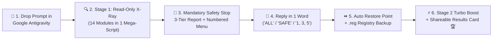

<div align="center">

# 🦅🇺🇦 ECHELON PC DOCTOR `v1.1`

### **Universal AI-Powered Windows 10/11 Audit, Cleanup, Debloat, Security & FPS Optimization System — For All PC Users & Gamers Worldwide**
*Created for players of **[Echelon UA — TOP SCUM Game Server by Medishe](https://www.echelon-scum.com/)** & the global PC / Gaming community*

[](https://www.echelon-scum.com/)
[-0078D6?style=for-the-badge&logo=windows&logoColor=white)](https://www.echelon-scum.com/)
[](https://antigravity.google/)
[](./ECHELON_PC_DOCTOR_UA.md)
[](#-why-echelon-pc-doctor-beats-traditional-cleaners--tweakers)
[-ff9900?style=for-the-badge)](./ECHELON_PC_DOCTOR_EN.md)
[](./LICENSE)
[](https://www.echelon-scum.com/)
[](https://savelife.in.ua/)

<br>

[](#-full-capabilities--feature-overview-14-engineering-modules)
[](#-full-capabilities--feature-overview-14-engineering-modules)
[](#-full-capabilities--feature-overview-14-engineering-modules)
[](#-full-capabilities--feature-overview-14-engineering-modules)
[](#-full-capabilities--feature-overview-14-engineering-modules)

---

**[🇬🇧 English Documentation](#-english-documentation) | [🇺🇦 Українська Інструкція](#-українська-інструкція)**

📄 **Prompt Files in this Repository:**
* 🇺🇦 **[`ECHELON_PC_DOCTOR_UA.md`](./ECHELON_PC_DOCTOR_UA.md)** — Full Ukrainian Edition (`v1.1`)
* 🇬🇧 **[`ECHELON_PC_DOCTOR_EN.md`](./ECHELON_PC_DOCTOR_EN.md)** — Full English Edition (`v1.1`)
*(💡 Both `_UA` and `_EN` files are 100% identical in functionality — either version will work on your PC, simply ask the AI agent to speak your preferred language! Supports all world languages except Russian, which is strictly blocked).*

⭐ **If this tool freed up gigabytes on your SSD or boosted your FPS — please give this repository a Star (⭐) at the top right and share it with your friends!**

</div>

---

# 🇬🇧 English Documentation

> 🦅🇺🇦 **Created for players of Echelon UA — TOP SCUM game server by Medishe ([https://www.echelon-scum.com/](https://www.echelon-scum.com/)). Did it help? — Donate to the Armed Forces of Ukraine (ZSU)!** 💪🇺🇦

### 🚀 Turn Your PC or Laptop Into a High-FPS Machine — Safely, Transparently & For Free!

Most PCs lose **15–30% of their gaming performance** and **50–200+ GB of fast SSD space** over time due to hidden Windows bottlenecks, outdated duplicate driver repositories, background tray parasites, unoptimized BIOS/RAM settings, and shader cache stutters. Meanwhile, commercial "PC cleaners" (*CCleaner, Driver Booster*, etc.) only slow your system down with ads and telemetry.

**ECHELON PC DOCTOR (`v1.1`)** is a 100% universal engineering system prompt **specifically built, tested, and optimized for the free [Google Antigravity](https://antigravity.google/) AI environment** *(other AI tools with terminal access can also be used)*. Designed originally by the **Echelon UA** community, it works for **every Windows 10/11 desktop PC or laptop user in the world** — whether you are a **Gamer** (playing *CS2, S.T.A.L.K.E.R. 2, Dota 2, Rust, DayZ, Cyberpunk 2077, PUBG, Warzone, Fortnite, Battlefield*, or **SCUM**), a **Video Editor / 3D Artist**, a **Musician / Sound Engineer**, a **Software Developer**, or a **Home / Office PC user** (even if you have zero games installed!).

It transforms your AI agent into a **Senior Systems & Performance Engineer** that automatically adapts to your exact hardware (**Intel or AMD Ryzen / X3D CPUs**, **NVIDIA GeForce, AMD Radeon, or Intel Arc GPUs**) and installed software:

1. 🔍 **Stage 1 — 100% Safe Read-Only X-Ray:** Scans all drives, hardware buses, registry keys, startup sources, home LAN/Wi-Fi devices, and game settings **without deleting or changing a single byte**.
2. 🛡️ **"Do No Harm" & Full User Control (2-Turn Quick Menu):** Even with *"Always allow"* enabled, the agent **stops completely after the scan**, compresses healthy modules into 1 line, presents a 3-Tier Report (**🟢 Safe Junk**, **🟡 Your Choice**, **🔴 Hardware & Admin Tuning**), protects all personal files/saves/passwords, and gives you a **1-Line Quick-Reply Menu (`ALL`, `SAFE`, `1, 3, 5`, `ALL -2`)** saving up to **80% of AI tokens**!
3. ⚡ **Stage 2 — Autopilot Execution (`MEGA-BATCHING`) with System Restore & 1-Click Undo (`UNDO_RESTORE_DEFAULTS.bat`):** Automatically creates a **Windows System Restore Point, `.reg` backup, and a 1-click rollback script `C:\Echelon_Backup\UNDO_RESTORE_DEFAULTS.bat`** first, executes only what you approved in 1–2 master scripts, and generates a shareable **"Before / After Results Card"**!



### 🖥️ Live Preview: What Your Final "Before / After" Results Card Looks Like

```text
╔══════════════════════════════════════════════════════════════════════════════╗
║  🦅🇺🇦 ECHELON PC DOCTOR v1.1 — BEFORE / AFTER RESULTS CARD                   ║
╠══════════════════════════════╦═══════════════════════╦═══════════════════════╣
║ Metric / Subsystem           ║ BEFORE (Audit)        ║ AFTER (Optimized)     ║
╠══════════════════════════════╬═══════════════════════╬═══════════════════════╣
║ 💾 Free SSD Space (C: + D:)  ║ 41.2 GB free          ║ 128.6 GB (+87.4 GB!)  ║
║ 🧠 Idle RAM Usage & Startup  ║ 7.8 GB (19 tray apps) ║ 4.1 GB (-3.7 GB RAM!) ║
║ 🎮 GPU / Resizable BAR / VBS ║ VBS On / Shader 4 GB  ║ VBS Off / Cache 100GB ║
║ 🌐 DNS Ping & Home Wi-Fi/LAN ║ 38 ms / 11 LAN devs   ║ 8 ms (1.1.1.1) / Safe ║
║ 🛡️ Registry & DriverStore    ║ 1,420 dead keys / 18GB║ Cleaned + .reg Backup ║
╚══════════════════════════════╩═══════════════════════╩═══════════════════════╝
🦅🇺🇦 Created for Echelon UA — TOP SCUM Server by Medishe (echelon-scum.com)
💛💙 Did it help? — Donate to the Armed Forces of Ukraine (ZSU)! 💪🇺🇦
```

---

## ⚖️ Why ECHELON PC DOCTOR Beats Traditional "Cleaners" & Tweakers

| Feature / Safety | ❌ Traditional Commercial "Cleaners" | ⚠️ Blind `.bat` Tweaker Scripts from YouTube | ✅ **ECHELON PC DOCTOR `v1.1` (AI Agent)** |
| :--- | :--- | :--- | :--- |
| **How it works** | Runs persistent background services, promotional pop-ups & telemetry | Blindly edits registry keys without checking your hardware | **Reads your exact hardware & OS first**, explains every finding |
| **User Control** | Deletes files behind a "Clean" button without details | All-or-nothing script that often breaks Windows features | **Human-in-the-Loop:** asks your permission for every critical action |
| **CPU & GPU Awareness** | None (generic rules across all CPUs/GPUs) | Applies generic tweaks that hurt **AMD Ryzen X3D** or laptops | Custom rules for **Intel P+E Cores, AMD Ryzen / Dual-CCD X3D, NVIDIA, Radeon & Intel Arc** |
| **Safety & Rollback** | Limited backup options | Often disables System Restore | Mandatory **Read-Only Stage 1 + System Restore Point + 1-Click `UNDO` Script** |
| **Price & Privacy** | Paid subscriptions, promotional bundles | Free, but risky | **100% Free, Open-Source (MIT), Zero Ads, Zero Telemetry** |

---

## 🔥 Full Capabilities & Feature Overview (14 Engineering Modules)

| # | Engineering Module | Complete List of Functions & What It Does for Your PC |
| :---: | :--- | :--- |
| **1** | **Storage Architecture, NVMe PCIe, `BypassIO` & NTFS Health** | • Audits all SSDs/HDDs (`HealthStatus`, temperature, wear, `GPT` vs `MBR`, `FirmwareVersion` updates).<br>• Verifies NVMe PCIe Gen 3/4/5 link speed & width (`x4` vs throttled `x2`), checks Windows 11 **`DirectStorage / BypassIO`** (`fsutil bypassio state`), and checks if Windows is on your fastest SSD.<br>• Checks `4K` partition alignment, finds lost unallocated space, recovers **phantom missing NTFS gigabytes** (`chkdsk /f /x`), and removes accidental NTFS compression (blue arrows) using **16-thread parallel Win32 decompression**. |
| **2** | **Windows System Junk, `Windows.edb`, `DriverStore` & `pagefile.sys`** | • Cleans `%TEMP%`, Windows Update caches, `Windows.old`, crash dumps (decoding any recent **`BSOD / BugCheck`** causes first!), oversized `VSS` shadow copies, bloated **`Windows.edb` Search Index (10–40 GB)**, excludes game folders from `WSearch` indexing, and auto-heals system corruption (`DISM` + `SFC`).<br>• **Safe `DriverStore` Deduplication:** removes old superseded NVIDIA/AMD/Intel/Realtek driver packages in `DriverStore\FileRepository` without touching active drivers (**frees 5–30+ GB on `C:`!**).<br>• **Universal Anti-Crash Memory Guard:** disables/reduces `hiberfil.sys` and places a `16 GB+` `pagefile.sys` on your fastest NVMe SSD to eliminate *Out of video memory / Fatal Error* crashes in all modern games (*SCUM, S.T.A.L.K.E.R. 2, Rust, DayZ, Cyberpunk 2077*)! |
| **3** | **Deep `AppData`, `ProgramData` & iPhone Backup Purge** | • Scans user profiles, lists TOP-15 space hogs, detects hidden **50–150 GB iPhone/iPad backups** (`Apple MobileSync\Backup`), and checks for overloaded `Desktop` folders / *OneDrive* sync traps.<br>• Purges multi-gigabyte shader/OTA caches (`NVIDIA OTA`, `D3DSCache`, `DXCache`, `Radeon DxCache/Dx9Cache/VkCache`, `Intel ShaderCache`), installer caches (`Package Cache`), and messenger media caches (*Telegram, Viber, Discord, Spotify*). |
| **4** | **All Installed Games Audit (with SCUM Sub-Context) & Pro Apps** | • **All Installed Games Inventory:** automatically detects **every game** across *Steam, Epic, Battle.net, EA, Ubisoft, GOG, Xbox, Riot* — checks drive placement (`NVMe` vs slow `HDD/SATA`), cleans old crash dumps across all engines (UE4/UE5/Unity) without touching saves, resolves **"Overlay Wars"** & Windows 11 `MPO` stutters, and includes a **dedicated SCUM sub-context** (`GameUserSettings.ini` VRAM pool + `EasyAntiCheat` & server-join crash recovery).<br>• **Creators & Devs:** finds hidden multi-GB caches in *Adobe Premiere/After Effects/CameraRaw*, *CapCut*, *DaVinci Resolve*, *Unreal Engine DDC*, duplicate *Cubase / Kontakt* sound libraries, and *Android Studio / JetBrains / Gradle / npm / Docker WSL2 `.vhdx` / Ollama AI* caches. |
| **5** | **Cyber-Hygiene 🚫, GitHub Open-Source 🐙 & `winget` 🔄** | • **Software Origin & Privacy Check 🚫:** informs the user about software and browser extensions originating from the Russian Federation jurisdiction (*Yandex, Kaspersky, Dr.Web, Lightshot, Punto Switcher, Zona, MediaGet, AIMP, Movavi, Reg Organizer, AdGuard*) and suggests global/Open-Source alternatives at the user's discretion.<br>• **Heavy Utilities $\rightarrow$ GitHub Open-Source 🐙:** suggests lightweight **GitHub Open-Source** alternatives (**BleachBit, BCUninstaller, qBittorrent, ShareX, 7-Zip, G-Helper**) for resource-heavy commercial utilities.<br>• **Freeware Auto-Updater 🔄:** updates **only free software** via official `winget` without touching paid/licensed pro suites. |
| **6** | **Browser Speedup, SQLite `VACUUM` & Background VRAM Guard** | • Cleans gigabytes of browser caches (*Chrome, Edge, Brave, Opera, Firefox*) and on-device AI weights.<br>• Uses native Windows `winsqlite3.dll` (even without Python!) to purge expired tracking cookies (>30 days unvisited) and physically compact `History` & `Cookies` databases via SQL `VACUUM` while keeping all active logins & passwords intact.<br>• **Game + Browser Map (`scum-map.com`) + Discord VRAM Guard:** optimizes browser `Sleeping Tabs` and Discord Hardware Acceleration to save **1–1.8 GB VRAM** on 6–8 GB GPUs! |
| **7** | **UWP Debloat & Windows 11 (23H2/24H2) Parasites** | • Audits all removable Microsoft Store apps by disk size and **last active date**, while protecting `Xbox/GamingServices` and hardware codecs (`HEVC, VP9, AV1`).<br>• Disables Windows 11 background hogs: Start Menu `Bing Web Search` keystroke lag, `Widgets.exe` WebView2 RAM drain, `Windows Recall`, and lock-screen ad suggestions. |
| **8** | **`Downloads`, TOP-20 Monster Files & Replay Buffers** | • Lists the **TOP-20 largest individual files (> 2–5 GB)** across all drives and forgotten installers in `Downloads`.<br>• Inspects *NVIDIA ShadowPlay / AMD Radeon ReLive / OBS* folders to ensure continuous **Instant Replay** recording buffers never throttle or wear out your OS or game SSD. |
| **9** | **Deep Windows Registry Cleanup (with `.reg` Backup)** | • Exports automatic `.reg` backups before cleaning.<br>• Removes orphaned keys of uninstalled software/adware, hundreds of dead `Installer\Folders` paths, thousands of accumulated dead `Audio\PolicyConfig\PropertyStore` sessions (fixing slow audio startup), and broken Windows Firewall rules. |
| **10** | **RAM Leaks, `Standby RAM`, Thermal Throttling & Smart CPU Tuning** | • Checks `Non-Paged Pool` kernel leaks, cached **`Standby RAM`**, smart **`MemoryCompression` (`Get-MMAgent`)**, disables the `Fast Startup` (`HiberbootEnabled`) kernel uptime trap, detects **CPU/GPU Thermal & Power Limit Throttling** (`Event ID 37` / dried thermal paste), and disables `PCIe ASPM`.<br>• **Smart CPU Core Parking:** preserves `3D V-Cache` CCD1 parking on dual-CCD **AMD Ryzen 7900X3D / 7950X3D / 9950X3D** (preventing a 15–25% FPS loss!) while unparking 100% of cores (`CPMINCORES = 100%`) on single-CCD Ryzen and Intel CPUs. |
| **11** | **5-Level Antivirus/Anti-Miner Radar, Autostart X-Ray & Home Wi-Fi/LAN Security** | • **🦠 5-Level Antivirus & Anti-Miner Scanner:** audits **suspicious Windows Defender Exclusions** added by trojans/repacks (`Get-MpPreference`), catches **fake system processes** (`svchost.exe` outside `System32`), verifies digital signatures (`Get-AuthenticodeSignature`), scans mining pool ports (`3333/4444/14444`), WMI fileless malware, and P2B proxy botnets (`Infatica P2B`).<br>• **6-Source Startup X-Ray:** scans `Run`, `WOW6432Node`, Task Manager `StartupApproved`, UWP `StartupTasks`, Task Scheduler `AtLogOn`, and `Edge Startup Boost` — safely disabling tray apps eating **1.5–4 GB RAM**.<br>• **Home Network & Wi-Fi Security Radar:** checks **Ethernet Cable link speed** (`100 Mbps` bottleneck vs `1–2.5 Gbps`) or **Wi-Fi band & encryption** (`2.4 GHz` lag vs `5/6 GHz`, `WPA2/WPA3`), lists **all active devices connected to your router** (LAN/Wi-Fi IP & MAC radar), checks for **ARP-Spoofing (MITM)**, exposed `RDP 3389`, & benchmarks live DNS in ms (`1.1.1.1` / `8.8.8.8` / `9.9.9.9`). |
| **12** | **WHQL Hardware Driver Currency Audit (Intel & AMD)** | • Audits **AMD Chipset Software / 3D V-Cache Optimizer** or **Intel Chipset / ME / IPF**, GPU (**NVIDIA Game Ready / AMD Adrenalin / Intel Arc**), ASIO/Realtek Audio, LAN/Wi-Fi/Bluetooth, and NVMe controllers against the latest official WHQL releases. |
| **13** | **BIOS Currency (Microcode / AGESA) & XMP / EXPO RAM** | • Checks motherboard BIOS against the manufacturer's support site (critical for Intel 13/14th Gen `0x12B` microcode & AMD AGESA `fTPM Stutter` / safe `SoC` voltage fixes).<br>• Verifies Dual-Channel operation and warns if fast DDR4/DDR5 RAM is stuck at base JEDEC speed (`2133 / 4800 MHz`) instead of full **Intel XMP / AMD EXPO / DOCP** frequency (`3200–3600 / 6000+ MHz`). |
| **14** | **Esports FPS for All Games & SCUM, GPU, `48 kHz` Audio, Mic & Ping** | • **Universal GPU & Monitor Tuning:** verifies PCIe link width & `Resizable BAR / AMD SAM`, disables Radeon `ULPS` stutter (`EnableUlps = 0`), expands GPU Shader Cache (`NVIDIA 10–100 GB` / `Radeon Always On`), binds the `.exe` of **all installed games** (`SCUM.exe`) to the discrete GPU on laptops, sets **`Full RGB (0–255)`** for clear night visibility, and eliminates the 3-second black screen on `Alt + Tab`.<br>• **FPS & Latency:** checks Windows 11 `VBS / HVCI` (**+5–15% FPS**), disables `Xbox GameDVR`, enables `HAGS`, `MSI Mode`, `DirectX Flip Model`, `VRR (G-SYNC / FreeSync)`, and checks `4000/8000 Hz` mouse polling CPU spikes.<br>• **Footsteps, Microphone & Ping:** verifies stereo audio (anti-mono), native **`48 kHz / 24-bit`** sample rate, **Microphone `Exclusive Mode` protection** (so SCUM never mutes Discord), removes `NetworkThrottlingIndex` limits, disables NIC `Interrupt Moderation = 0`, and adds all game & anti-cheat folders to Defender exclusions. |

---

## 🛠️ Step-by-Step Guide (Easy for Beginners & Pros — Takes 2 Minutes)

Even if you have never used GitHub or AI tools before, just follow these **5 simple steps**:

1. **📥 Step 1 — Install Google Antigravity & Pick the Right Model:**
   Go to 👉 **[https://antigravity.google/](https://antigravity.google/)**, click **Download**, install the program (just like any regular app), and sign in with your regular Google / Gmail account.
   * 🧠 **Which AI Model Should You Select in the Chat Dropdown?**
     * 💎 **If you have a PAID Subscription (Google Gemini Advanced / Google One AI Pro):** select **`Gemini 4 (Argon / Pro)`** — Google's flagship reasoning model, which will run all 14 modules in a single pass with maximum analytical depth!
     * 🆓 **If you are on the FREE Tier (No Subscription):** select **`Gemini Flash` (`Gemini 3.8 Flash`)** — it is smart, fast, and **uses minimal tokens so your free quota won't run out quickly**, and split the scan into 2 stages (see Step 4 below) to comfortably fit within free limits!
2. **📂 Step 2 — Download the Prompt File from GitHub to a Folder on Your PC:**
   * **Easiest way (Download ZIP):** At the top right of this GitHub page, click the green **`<> Code`** button $\rightarrow$ **`Download ZIP`**, and extract the folder anywhere on your PC (e.g., to your Desktop or `C:\PC_Optimization`).
   * **Or download just 1 file:** Click on **[`ECHELON_PC_DOCTOR_EN.md`](./ECHELON_PC_DOCTOR_EN.md)** in the file list above, click the **⬇️ (`Download raw file`)** icon at the top right of the file view, and save it into an empty folder on your PC *(🌍 Note: either `_EN` or `_UA` file works identically — we warmly welcome users from all around the free world and gladly support every language on Earth except Russian, because Russia is a terrorist state that violates international law 🚫)*.
3. **🖥️ Step 3 — Open the Folder in Google Antigravity:**
   Launch **Google Antigravity**, click **File $\rightarrow$ Open Folder...** in the top-left menu, and select the folder where you saved the file *(if asked "Do you trust the authors of the files in this folder?", click **Yes, I trust the authors**)*.
4. **🚀 Step 4 — Start the Safe Scan in the AI Chat (Stage 1):**
   In the AI chat panel on the right *(if the chat panel isn't visible, press `Ctrl + L` or click the AI chat icon at the top right)*, type:
   * **Full Run (ideal if you have a Google Gemini subscription):**
     ```text
     Run ECHELON_PC_DOCTOR_EN.md
     ```
   * **Split Run in 2 Stages (if you are on the Free Tier without a subscription, to fit free token limits):**
     ```text
     Run ECHELON_PC_DOCTOR_EN.md (Modules 1-7 only: Disks & Cache Cleanup)
     ```
     *(and once finished, open a new chat and run the second half: `Run ECHELON_PC_DOCTOR_EN.md (Modules 8-14 only: Registry, Security, Network, Drivers & FPS)`)*
   * 📄 **Auto-Saved Report (`ECHELON_AUDIT_REPORT.md` — Resuming & After Reboot):** The agent automatically saves your complete audit report and `[ ] / [x]` action checklist into **`ECHELON_AUDIT_REPORT.md`** in your folder! If your free token quota runs out, or if a new empty chat opens after you reboot your PC / configure BIOS, simply type: **`I rebooted my PC, continue and verify results from ECHELON_AUDIT_REPORT.md`**.
   * 💡 **IMPORTANT PRO TIP (Zero Click Spam):** When the agent asks permission to run its first terminal check, click the small arrow **`▼`** next to the **Allow / Run** button and select **"Always allow"**. The agent will finish the entire Read-Only scan in 1–2 minutes and **stop completely** to show you the report!
5. **⚡ Step 5 — Reply in 1 Word, Run the Admin File & Type `+` / `DONE` in Chat (Stages 2 & 3):**
   * At the bottom of the report, the agent will show a numbered menu `[1]`, `[2]`, `[3]`... Simply reply in chat with **`ALL`** (to apply all recommended optimizations), **`SAFE`** (only 100% safe junk cleanup), or specific numbers like **`1, 3, 5`**.
   * When the agent generates the final **`echelon_doctor_admin.bat`** file in your folder, open that folder in Windows Explorer and **right-click `echelon_doctor_admin.bat` $\rightarrow$ "Run as administrator"**.
   * 💬 **Don't close the chat yet!** As soon as the `.bat` window finishes, **return to the chat and type `+` or `DONE`** (and answer the agent's follow-up questions!) — the agent will verify that all tweaks applied properly, delete temporary `.bat` files, generate your **"Before / After Results Card"**, and help you fine-tune your in-game graphics or BIOS settings! *(📱 **Pro Tip:** if you need to reboot your PC or enter BIOS — **take a photo of the instructions on your phone** before restarting!).* 🎉

---

## ⏪ How to Roll Back "Everything As It Was" (Full Restore in 1 Minute)

Before changing a single setting on Stage 2, the AI agent automatically saves all your original states into **`C:\Echelon_Backup`** (registry `.reg` exports, startup state manifest, game `.ini.bak` configs, browser `Cookies.bak`) and creates a Windows System Restore Point. If you ever do something wrong or want to revert your PC back to its exact original state, you have **3 effortless ways**:

1. **🖱️ Method 1 — 1-Click Undo Script (`UNDO_RESTORE_DEFAULTS.bat`):**
   Open the folder **`C:\Echelon_Backup`**, right-click **`UNDO_RESTORE_DEFAULTS.bat` $\rightarrow$ "Run as administrator"**, and reboot your PC. It automatically restores your original registry keys, startup apps, network settings, power plan, and `VBS/HVCI` state!
2. **💬 Method 2 — Ask the AI Agent in Chat:**
   Simply type in the **Google Antigravity** chat:
   ```text
   Restore all settings as they were from C:\Echelon_Backup
   ```
   The agent will automatically read your saved backups and revert every change for you.
3. **🛡️ Method 3 — Windows System Restore Point (Built-in OS Rollback):**
   Press **`Win + R`** on your keyboard, type **`rstrui.exe`**, press **Enter**, and select the **`Before_Echelon_PC_Doctor`** restore point created right before Stage 2.

---
---

# 🇺🇦 Українська Інструкція

> 🦅🇺🇦 **Створено для гравців серверу Echelon UA — TOP SCUM game server by Medishe ([https://www.echelon-scum.com/](https://www.echelon-scum.com/)). Допомогло? — донать на ЗСУ!** 💪🇺🇦

### 🚀 Перетвори свій ПК або ноутбук на ракету — безпечно, прозоро та безкоштовно!

Більшість комп'ютерів із часом втрачають **15–30% ігрового FPS** та **від 50 до 200+ ГБ швидкого місця на SSD** через приховані системні обмеження Windows, десятки гігабайтів старих дублікатів драйверів, програми-паразити в автозавантаженні, неправильні налаштування BIOS/оперативки та мікрофрізи під час компіляції шейдерів. А популярні «оптимізатори» з інтернету (*CCleaner, Driver Booster* тощо) лише добивають систему рекламою та фоновою телеметрією.

**ECHELON PC DOCTOR (`v1.1`)** — це на 100% універсальний інженерний системний промпт, **спеціально розроблений, протестований та оптимізований для безкоштовного ШІ-середовища [Google Antigravity](https://antigravity.google/)** *(також можна використовувати інші ШІ-інструменти з доступом до термінала)*. Створений спільнотою **Echelon UA**, він ідеально підходить **для абсолютно кожного власника ПК або ноутбука на Windows 10/11** — незалежно від того, чи ви **Геймер** (граєте в *CS2, S.T.A.L.K.E.R. 2, Dota 2, Rust, DayZ, Cyberpunk 2077, PUBG, Warzone, Fortnite, Battlefield* або **SCUM**), **Відеомонтажер / 3D-дизайнер**, **Музикант / Звукорежисер**, **Програміст**, чи просто хочете почистити та прискорити свій **домашній / робочий ноутбук** (навіть якщо на ньому взагалі немає ігор!).

Промпт перетворює ШІ-агента на вашого персонального **Senior-інженера з системної архітектури та швидкодії**, який автоматично підлаштовується під ваше залізо (**процесори Intel або AMD Ryzen / X3D**, **відеокарти NVIDIA GeForce, AMD Radeon або Intel Arc**) та встановлені програми:

1. 🔍 **Етап 1 — 100% Безпечний рентген системи (Read-Only):** сканує всі диски, лінії PCIe, реєстр, автостарт, домашню мережу (Кабель / Wi-Fi / пристрої на роутері) та ігрові налаштування, **не видаляючи і не змінюючи жодного байта без вашого відома**.
2. 🛡️ **Доктрина «Не нашкодь» та Меню Коротких Команд (Економія до 80% токенів):** навіть при увімкненому режимі *«Always allow»* агент **повністю зупиняється після сканування**, стискає справні модулі в 1 рядок, формує звіт у 3 категоріях (**🟢 100% Безпечне сміття**, **🟡 На ваш вибір**, **🔴 Драйвери та Турбо-тюнінг**) і дає **меню відповідей одним словом (`ВСЕ`, `БАЗА`, `1, 3, 5`, `ВСЕ крім 2`)** без довгих переписок!
3. ⚡ **Етап 2 — Автопілот (`MEGA-BATCHING`) із Точкою відновлення та Кнопкою Відкату (`UNDO_RESTORE_DEFAULTS.bat`):** перед змінами автоматично створює **точку відновлення системи Windows, бекап реєстру `.reg` та готовий файл відкату в 1 клік `C:\Echelon_Backup\UNDO_RESTORE_DEFAULTS.bat`**, виконує лише схвалені вами пункти об'єднаним скриптом і генерує фінальну **«Картку Результатів До / Після»**!

### 🖥️ Приклад фінальної «Картки Результатів До / Після» у терміналі:

```text
╔══════════════════════════════════════════════════════════════════════════════╗
║  🦅🇺🇦 ECHELON PC DOCTOR v1.1 — КАРТКА РЕЗУЛЬТАТІВ ДО / ПІСЛЯ                 ║
╠══════════════════════════════╦═══════════════════════╦═══════════════════════╣
║ Показник / Підсистема        ║ ДО ОПТИМІЗАЦІЇ        ║ ПІСЛЯ ОПТИМІЗАЦІЇ     ║
╠══════════════════════════════╬═══════════════════════╬═══════════════════════╣
║ 💾 Вільно на SSD (C: + D:)   ║ 41.2 ГБ вільно        ║ 128.6 ГБ (+87.4 ГБ!)  ║
║ 🧠 Споживання RAM у простої  ║ 7.8 ГБ (19 автостарт) ║ 4.1 ГБ (-3.7 ГБ RAM!) ║
║ 🎮 Відеокарта / VBS / Шейдери║ VBS Увімк / Кеш 4 ГБ  ║ VBS Вимк / Кеш 100 ГБ ║
║ 🌐 Пінг DNS та Домашня мережа║ 38 мс / 11 пристроїв  ║ 8 мс (1.1.1.1) / Чисто║
║ 🛡️ Реєстр та DriverStore     ║ 1,420 сиріт / 18 ГБ   ║ Очищено + бекап .reg  ║
╚══════════════════════════════╩═══════════════════════╩═══════════════════════╝
🦅🇺🇦 Створено для гравців серверу Echelon UA — TOP SCUM game server by Medishe
💛💙 Допомогло? — донать на ЗСУ! 💪🇺🇦
```

---

## ⚖️ Чому ECHELON PC DOCTOR кращий за традиційні «очищувачі» та твікери

| Критерій / Безпека | ❌ Традиційні комерційні «очищувачі» | ⚠️ Сліпі `.bat`-твікери з YouTube / Форумів | ✅ **ECHELON PC DOCTOR `v1.1` (ШІ-Інженер)** |
| :--- | :--- | :--- | :--- |
| **Принцип роботи** | Тримають фонові служби, рекламні банери та телеметрію | Наосліп змінюють реєстр, не знаючи вашого заліза | **Спочатку вивчає саме ваше залізо та ОС** і пояснює кожен пункт |
| **Контроль користувача** | Ховає деталі за однією кнопкою «Очистити» | Принцип «усе або нічого», часто ламає служби Windows | **Human-in-the-Loop:** запитує ваш дозвіл щодо кожного важливого рішення |
| **Врахування CPU та GPU** | Ніякого (однакові правила для всіх ПК) | Шаблонні твіки, які ріжуть FPS на **Ryzen X3D** чи ноутбуках | Індивідуальні правила під **Intel P+E Cores, AMD Ryzen / Dual-CCD X3D, NVIDIA, Radeon та Intel Arc** |
| **Безпека та відкат** | Обмежені можливості бекапу | Часто вимикає точки відновлення системи | Обов'язковий **Read-Only Етап 1 + Точка відновлення + Скрипт `UNDO` в 1 клік** |
| **Ціна та приватність** | Платні підписки, рекламні пропозиції | Безкоштовно, але на власний страх і ризик | **100% Безкоштовно, Open-Source (MIT), 0 реклами, 0 телеметрії** |

---

## 🔥 Що вміє ця система — Повний огляд усіх функцій (14 інженерних модулів)

| # | Інженерний модуль | Повний опис функцій та що це дає вашому ПК |
| :---: | :--- | :--- |
| **1** | **Архітектура дисків, шина NVMe PCIe, `BypassIO` та здоров'я NTFS** | • Повна перевірка всіх SSD та HDD (`HealthStatus`, температура, знос, `GPT` чи `MBR`, актуальність прошивки `FirmwareVersion`).<br>• Контроль реальної швидкості ліній NVMe PCIe Gen 3/4/5 (`x4` чи урізаний `x2`), перевірка прямого каналу **`DirectStorage / BypassIO`** (`fsutil bypassio state`) у Windows 11 та чи стоїть ОС на найшвидшому диску.<br>• Перевірка вирівнювання розділів `4K`, пошук втрачених нерозподілених гігабайтів, миттєве повернення **«фантомно зниклого» місця NTFS** (`chkdsk /f /x`) та зняття випадкового стиснення NTFS (синіх стрілок) у **16 потоків через Win32 API**. |
| **2** | **Системне сміття Windows, `Windows.edb`, `DriverStore` та `pagefile.sys`** | • Очищення `%TEMP%`, кешів оновлень Windows, `Windows.old`, дампів падінь (із попередньою розшифровкою причин «Синіх екранів» **`BSOD / BugCheck`**!), роздутих тіньових копій `VSS`, роздутої бази пошуку **`Windows.edb` (10–40 ГБ)** із виключенням папок ігор з індексації `WSearch`, та авто-лікування системних файлів (`DISM` + `SFC`).<br>• **Безпечна дедуплікація `DriverStore`:** видаляє старі неактивні дублікати пакетів драйверів NVIDIA/AMD/Intel/Realtek у `DriverStore\FileRepository`, не чіпаючи поточні драйвери (**звільняє 5–30+ ГБ на диску `C:`!**).<br>• **Захист усіх сучасних ігор та SCUM від вильотів по пам'яті:** вимикає/стискає `hiberfil.sys` і налаштовує `pagefile.sys` (`16 ГБ+` виключно на швидкому NVMe SSD), що повністю прибирає вильоти *Out of video memory / Fatal Error* у сучасних іграх (*SCUM, S.T.A.L.K.E.R. 2, Rust, DayZ, Cyberpunk 2077*)! |
| **3** | **Очищення `AppData`, `ProgramData` та бекапів iPhone** | • Сканує профілі користувачів, знаходить ТОП-15 найбільших папок, виявляє приховані **бекапи iPhone/iPad на 50–150 ГБ** (`Apple MobileSync\Backup`) та перевіряє перевантаженість Робочого столу (`Desktop`) / пастку синхронізації *OneDrive*.<br>• Вичищає багатогігабайтні кеші шейдерів та апдейтерів (`NVIDIA OTA`, `D3DSCache`, `DXCache`, `Radeon DxCache/Dx9Cache/VkCache`, `Intel ShaderCache`), інсталяційні кеші (`Package Cache`) та медіа-кеші месенджерів (*Telegram, Viber, Discord, Spotify*). |
| **4** | **Аудит УСІХ встановлених ігор (із спец-підконтекстом SCUM) та Проф-софту** | • **Інвентаризація всіх ігор на ПК:** автоматично знаходить **усі встановлені ігри** (*Steam, Epic, Battle.net, EA, Ubisoft, GOG, Xbox, Riot*) — перевіряє диск встановлення (`NVMe` чи повільний `HDD/SATA`), чистить краш-логи всіх рушіїв (UE4/UE5/Unity) без ризику для збережень, усуває **«Війну оверлеїв»** і баг `MPO` у Windows 11 та має **спеціальний підконтекст для SCUM** (ліміт VRAM у `GameUserSettings.ini` + реанімація `EasyAntiCheat` і конфігів при вильотах на вході на сервер).<br>• **Для Монтажерів, Музикантів та Розробників:** знаходить приховані гігантські кеші *Adobe Premiere/After Effects/CameraRaw*, *CapCut*, *DaVinci Resolve*, *Unreal Engine DDC*, дублікати бібліотек *Cubase / Kontakt*, а також кеші *Android Studio / JetBrains / Gradle / npm / Docker WSL2 `.vhdx` / локальних ШІ-моделей Ollama*. |
| **5** | **Кібергігієна 🚫, Open-Source з GitHub 🐙 та `winget` 🔄** | • **Інформування про походження ПЗ 🚫:** інформує користувача про програми та розширення браузерів походженням із юрисдикції рф (*Yandex, Kaspersky, Dr.Web, Lightshot, Punto Switcher, Zona, MediaGet, AIMP, Movavi, Reg Organizer, AdGuard*) і за бажанням користувача пропонує світові/Open-Source аналоги.<br>• **Легкі Open-Source аналоги з GitHub 🐙:** пропонує за вибором користувача замінити ресурсоємні утиліти на легкі відкриті програми з GitHub (**BleachBit, BCUninstaller, qBittorrent, ShareX, 7-Zip, G-Helper**).<br>• **Авто-оновлення безкоштовних програм 🔄:** оновлює **лише безкоштовний софт** через офіційний `winget`, не чіпаючи платні професійні програми. |
| **6** | **Прискорення браузерів, стиснення SQLite `VACUUM` та захист VRAM** | • Очищує гігабайти файлового кешу браузерів (*Chrome, Edge, Brave, Opera, Firefox*) та локальні ШІ-моделі.<br>• Напряму через системну бібліотеку Windows `winsqlite3.dll` (навіть без встановленого Python!) видаляє сміттєві трекінгові кукі сайтів, на які ви не заходили понад 30 днів, і фізично стискає бази `History` та `Cookies` командою `VACUUM`, зберігаючи всі ваші логіни й паролі.<br>• **Захист VRAM при відкритих «Гра + Карта (`scum-map.com`) + Discord»:** оптимізує `Sleeping Tabs` у браузері та апаратне прискорення Discord, звільняючи **1–1.8 ГБ відеопам'яті** на картах із 6–8 ГБ VRAM! |
| **7** | **Очищення UWP-сміття та фонових паразитів Windows 11 (23H2/24H2)** | • Аналізує стандартні програми Windows за розміром та **датою останнього запуску**, гарантовано зберігаючи ігрові служби (`Xbox/GamingServices`) та відеокодеки (`HEVC, VP9, AV1`).<br>• Вимикає нових пожирачів ресурсів Windows 11: інтернет-пошук `Bing` у меню «Пуск», фоновий браузер віджетів `Widgets.exe`, службу `Windows Recall` та рекламні рекомендації. |
| **8** | **Ревізія `Downloads`, ТОП-20 файлів-монстрів та буфера запису** | • Виводить список **ТОП-20 найбільших окремих файлів (> 2–5 ГБ)** по всіх дисках та забутих інсталяторів у `Downloads`.<br>• Перевіряє папки відеозаписів *NVIDIA ShadowPlay / AMD Radeon ReLive / OBS*, щоб постійний буфер миттєвого повтору (*Instant Replay*) не гальмував і не зношував диск із системою або грою. |
| **9** | **Глибоке очищення реєстру Windows (із бекапом `.reg`)** | • Обов'язково створює резервну копію `.reg` перед будь-яким очищенням.<br>• Видаляє осиротілі гілки давно видалених програм та Adware, сотні мертвих шляхів інсталяторів у `Installer\Folders`, тисячі накопичених мертвих аудіосесій у `Audio\PolicyConfig\PropertyStore` (які гальмують звук) та биті правила Брандмауера. |
| **10** | **Оперативна пам'ять, `Standby RAM`, Тротлінг та тюнінг CPU** | • Перевіряє витоки ядра `Non-Paged Pool`, кешовану **`Standby RAM`**, статус стиснення пам'яті **`MemoryCompression` (`Get-MMAgent`)**, вимикає пастку `Fast Startup` (`HiberbootEnabled`), діагностує **перегрів та скидання частот CPU/GPU** (`Event ID 37` / висохла термопаста) і вимикає `PCIe ASPM`.<br>• **Розумне керування ядрами CPU:** зберігає правильне паркування другого чіплета на двочіплетних **AMD Ryzen 7900X3D / 7950X3D / 9950X3D** для максимальної роботи `3D V-Cache` (захищаючи від втрати 15–25% FPS!), і водночас розпарковує 100% ядер (`CPMINCORES = 100%`) на одночіплетних Ryzen та процесорах Intel. |
| **11** | **5-Рівневий Антивірус/Анти-Майнер, Автостарт (6 джерел) та Домашня мережа** | • **🦠 5-Рівневий Антивірусний та Анти-Майнер Дефектоскоп:** викриває **підозрілі виключення Windows Defender**, куди ховаються трояни й віруси з репаків (`Get-MpPreference`), ловить **процеси-перевертні** (`svchost.exe` поза `System32`), перевіряє цифрові підписи (`Get-AuthenticodeSignature`), порти майнінг-пулів (`3333/4444/14444`), безфайлові WMI-віруси та проксі-ботнети (`Infatica P2B`).<br>• **Рентген 6 джерел Автостарту:** сканує `Run`, `WOW6432Node`, статус у Диспетчері завдань `StartupApproved`, UWP `StartupTasks`, Планувальник `AtLogOn` та `Edge Startup Boost` — безпечно вимикаючи лаунчери й торренти, які жеруть **1.5–4 ГБ RAM**.<br>• **Радар домашньої мережі (Кабель / Wi-Fi / Пристрої на роутері):** перевіряє швидкість кабелю (`100 Мбіт/с` проти `1–2.5 Гбіт/с`) або частоту й захист **Wi-Fi** (`2.4 GHz` проти `5/6 GHz`, `WPA2/WPA3`), виводить **список усіх пристроїв, підключених до вашого роутера**, перевіряє мережу на **ARP-Spoofing**, відкритий порт `RDP 3389` і тестує DNS (`1.1.1.1` / `8.8.8.8` / `9.9.9.9`). |
| **12** | **Аудит актуальності WHQL-драйверів (Intel та AMD)** | • Перевіряє драйвери **AMD Chipset Software / 3D V-Cache Optimizer** або **Intel Chipset / ME / IPF**, відеокарт (**NVIDIA Game Ready / AMD Adrenalin / Intel Arc**), звукових карт ASIO/Realtek, мережі LAN/Wi-Fi/Bluetooth та NVMe-контролерів у порівнянні з найсвіжішими офіційними WHQL-релізами. |
| **13** | **Актуальність BIOS (Microcode / AGESA) та пам'ять XMP / EXPO** | • Звіряє версію BIOS із офіційним сайтом виробника материнської плати (критично для мікрокодів Intel 13/14-Gen `0x12B` та оновлень AMD AGESA проти мікрофрізів звуку `fTPM Stutter` і стрибків напруги `SoC`).<br>• Перевіряє двоканальний режим та попереджає, якщо швидка пам'ять DDR4/DDR5 працює на базовій частоті JEDEC (`2133 / 4800 МГц`) замість повної швидкості **Intel XMP / AMD EXPO / DOCP** (`3200–3600 / 6000+ МГц`). |
| **14** | **Кіберспортивний FPS для всіх ігор та SCUM, GPU, Звук `48 kHz`, Мікрофон і Пінг** | • **Універсальний тюнінг відеокарти та монітора:** перевіряє лінії PCIe та `Resizable BAR / AMD SAM`, вимикає глибокий сон Radeon `ULPS` (`EnableUlps = 0`), розширює кеш шейдерів (`NVIDIA 10–100 ГБ` / `Radeon Always On`), прив'язує `.exe` **всіх ігор** (`SCUM.exe`) до дискретної відеокарти на ноутбуках, вмикає **`Full RGB (0–255)`** для видимості вночі та прибирає 3-секундний чорний екран при `Alt + Tab`.<br>• **Максимум FPS та низький інпут-лаг:** перевіряє `VBS / HVCI` (**+5–15% FPS**), вимикає `Xbox GameDVR`, активує `HAGS`, `MSI Mode`, `DirectX Flip Model`, `VRR (G-SYNC / FreeSync)` і попереджає про статтери мишей `4000/8000 Hz`.<br>• **Звук кроків, Мікрофон та мінімальний пінг:** перевіряє стереопанораму кроків (анти-моно), рідну частоту **`48 kHz / 24-bit`**, захист **Мікрофона (`Exclusive Mode`)**, щоб голос не пропадав у SCUM та Discord, знімає ліміт `NetworkThrottlingIndex`, вимикає `Interrupt Moderation = 0` та додає папки ігор у виключення Defender. |

---

## 🛠️ Покрокова інструкція: Як почати (Зрозуміло навіть новачкам — за 2 хвилини)

Навіть якщо ви ніколи раніше не користувалися GitHub або ШІ-програмами, просто виконайте ці **5 простих кроків**:

1. **📥 Крок 1 — Встановіть програму Google Antigravity та оберіть оптимальну модель ШІ:**
   Перейдіть на офіційний сайт 👉 **[https://antigravity.google/](https://antigravity.google/)**, натисніть **Download**, встановіть програму (як звичайну гру чи браузер) і увійдіть під своїм звичайним Google-акаунтом (поштою Gmail).
   * 🧠 **Яку модель ШІ обрати у випадаючому списку внизу чату?**
     * 💎 **Якщо у вас ПЛАТНА підписка (Google Gemini Advanced / Google One AI Pro):** рекомендуємо обрати флагманську модель **`Gemini 4 (Argon / Pro)`** — вона має найвищий інженерний інтелект і легко виконає всі 14 модулів за один прохід!
     * 🆓 **Якщо ви на БЕЗКОШТОВНОМУ тарифі (без підписки):** рекомендуємо обрати модель **`Gemini Flash` (`Gemini 3.8 Flash`)** — вона дуже розумна, чудово пише PowerShell-скрипти, працює миттєво і **не «з'їдає» швидко безкоштовні ліміти токенів**, а саму перевірку розділіть на 2 етапи (див. Крок 4 нижче)!
2. **📂 Крок 2 — Завантажте файл із GitHub у папку на ПК:**
   * **Найпростіший спосіб (Скачати архів):** Угорі цієї сторінки GitHub натисніть зелену кнопку **`<> Code` $\rightarrow$ `Download ZIP`** і розпакуйте завантажений архів у будь-яку папку на комп'ютері (наприклад, на Робочий стіл або `C:\PC_Optimization`).
   * **Або скачайте лише 1 файл:** Натисніть у списку файлів угорі на **[`ECHELON_PC_DOCTOR_UA.md`](./ECHELON_PC_DOCTOR_UA.md)**, потім у правому верхньому куті над текстом натисніть значок завантаження **⬇️ (`Download raw file`)** і покладіть файл у нову порожню папку на ПК *(🌍 Примітка: будь-яка версія — `_UA` або `_EN` — працює однаково: ми щиро раді користувачам з усього вільного світу та охоче підтримуємо всі мови світу, окрім росіян і російської мови, оскільки росія — це держава-терорист, яка порушує міжнародне право 🚫)*.
3. **🖥️ Крок 3 — Відкрийте цю папку в Google Antigravity:**
   Запустіть програму **Google Antigravity**, натисніть у верхньому лівому меню **File $\rightarrow$ Open Folder...** і виберіть папку, куди ви поклали файл *(якщо з'явиться віконце «Do you trust the authors of the files in this folder?» — натисніть синю кнопку **Yes, I trust the authors**)*.
4. **🚀 Крок 4 — Запустіть безпечне сканування в чаті ШІ (Етап 1):**
   У вікні чату зі штучним інтелектом справа *(якщо вікно чату не відкрите — натисніть комбінацію клавіш `Ctrl + L` або іконку чату у верхньому правому куті)* напишіть:
   * **Варіант А — Повний запуск (якщо у вас є підписка Google Gemini):**
     ```text
     Виконай ECHELON_PC_DOCTOR_UA.md
     ```
   * **Варіант Б — Поетапний запуск у 2 частини (якщо ви на безкоштовному тарифі без підписки, щоб вкластися в ліміти):**
     ```text
     Виконай ECHELON_PC_DOCTOR_UA.md (тільки Модулі 1–7: Очищення дисків і кешів)
     ```
     *(а після завершення першої частини відкрийте новий чат і запустіть другу половину: `Виконай ECHELON_PC_DOCTOR_UA.md (тільки Модулі 8–14: Реєстр, Безпека, Мережа, Драйвери та FPS)`)*
   * 📄 **Автозбереження звіту у файл (`ECHELON_AUDIT_REPORT.md` — для продовження та після ребуту):** Агент автоматично записує весь звіт перевірки та чек-лист виконаних/очікуючих пунктів `[ ] / [x]` у файл **`ECHELON_AUDIT_REPORT.md`** у вашій папці! Якщо у вас закінчилися безкоштовні ліміти токенів, або після перезавантаження ПК / налаштування BIOS відкрився новий порожній чат — просто напишіть: **`Я перезавантажив ПК, продовж і перевір результати за файлом ECHELON_AUDIT_REPORT.md`**.
   * 💡 **ВАЖЛИВИЙ ЛАЙФХАК (Щоб не клікати «Allow» десятки разів):** Коли агент вперше попросить дозвіл запустити команду в терміналі, натисніть маленьку стрілочку **`▼`** біля кнопки **Allow / Run** і виберіть **«Always allow»**. Агент сам проведе повну безпечну перевірку за 1–2 хвилини і **повністю зупиниться**, показавши вам таблицю результатів!
5. **⚡ Крок 5 — Напишіть одне слово, запустіть адмін-файл та напишіть `+` / `ГОТОВО` у чат (Етапи 2 та 3):**
   * У кінці звіту агент покаже пронумероване меню `[1]`, `[2]`, `[3]`... Просто напишіть йому у відповідь одне слово: **`ВСЕ`** (виконати всі рекомендовані оптимізації), або **`БАЗА`** (лише 100% безпечне очищення сміття), або перелічіть потрібні номери через кому, наприклад: **`1, 3, 5`**.
   * Коли агент виконає очищення і створить у вашій папці фінальний файл **`echelon_doctor_admin.bat`** — відкрийте цю папку на комп'ютері та натисніть на файл **`echelon_doctor_admin.bat` правою кнопкою миші $\rightarrow$ «Запустити від імені адміністратора»**.
   * 💬 **Не закривайте чат одразу після `.bat`-файлу!** Щойно вікно скрипта виконається, **поверніться в чат і напишіть `+` або `ГОТОВО`** (та дайте відповідь на навідні питання агента!) — агент перевірить, скільки гігабайтів реально звільнилося, прибере тимчасові файли, видасть вашу фінальну **«Картку Результатів До / Після»** і допоможе ідеально налаштувати графіку в грі чи BIOS! *(📱 **Порада:** якщо потрібно перезавантажити комп'ютер або зайти в BIOS — обов'язково **сфотографуйте інструкцію на телефон** перед перезапуском!).* 🎉

---

## ⏪ Як повернути «Все як було» (Інструкція повного відкату налаштувань)

Перед внесенням будь-яких змін на Етапі 2 ШІ-агент обов'язково зберігає всі ваші початкові налаштування у папку **`C:\Echelon_Backup`** (резервні копії гілок реєстру `.reg`, список початкового стану програм в автозавантаженні, копії конфігів ігор `.ini.bak`, бекап кукі браузера `Cookies.bak`) і створює системну Точку відновлення Windows. Якщо ви випадково обрали не той пункт або хочете повернути комп'ютер до стану «все як було до оптимізації», у вас є **3 прості способи**:

1. **🖱️ Спосіб 1 — Відкат в 1 клік через скрипт (`UNDO_RESTORE_DEFAULTS.bat`):**
   Відкрийте на диску `C:` папку **`C:\Echelon_Backup`**, натисніть правою кнопкою миші на файл **`UNDO_RESTORE_DEFAULTS.bat` $\rightarrow$ «Запустити від імені адміністратора»** і перезавантажте ПК. Скрипт автоматично імпортує ваші старі `.reg`-файли і поверне попередні налаштування реєстру, автостарту, мережі, живлення та `VBS/HVCI`!
2. **💬 Спосіб 2 — Написати одну фразу в чат Google Antigravity:**
   Просто напишіть у чат ШІ-агенту:
   ```text
   Поверни всі налаштування як було з папки C:\Echelon_Backup
   ```
   Агент сам прочитає збережені бекапи у `C:\Echelon_Backup` і автоматично поверне всі параметри назад.
3. **🛡️ Спосіб 3 — Штатна Точка відновлення Windows (`rstrui.exe`):**
   Натисніть на клавіатурі комбінацію **`Win + R`**, введіть команду **`rstrui.exe`**, натисніть **Enter** і виберіть зі списку точку відновлення **`Before_Echelon_PC_Doctor`**, створену перед запуском оптимізації.

---

## ❓ Часті питання (FAQ) / Frequently Asked Questions

<details>
<summary><b>🎮 Як виправити мікрофрізи (stutters) і підняти 1% Low FPS у SCUM, CS2, S.T.A.L.K.E.R. 2, Rust та іграх на Unreal Engine 4/5? / How to fix micro-stutters and boost 1% Low FPS?</b></summary>
<br>
Промпт усуває всі 7 головних причин мікрофрізів у сучасних іграх: розширює кеш шейдерів відеокарти (<code>10–100 GB</code> на NVIDIA / <code>Always On</code> на Radeon), вимикає глибокий сон <code>ULPS</code> на AMD Radeon, налаштовує <code>16 ГБ+ pagefile.sys</code> на найшвидшому NVMe SSD (прибирає вильоти <i>Out of video memory</i>), усуває конфлікт оверлеїв та баг Windows 11 <code>MPO</code>, вимикає <code>VBS / HVCI</code> (<b>+5–15% FPS</b>), правильно налаштовує паркування ядер на процесорах <b>AMD Ryzen X3D</b> та додає папки ігор у виключення Windows Defender.
</details>

<details>
<summary><b>💾 Як безпечно звільнити 50–150+ ГБ на диску C: (SSD) без видалення особистих файлів, паролів і збережень ігор? / How to safely free 50–150+ GB on C: drive?</b></summary>
<br>
На Етапі 1 агент працює виключно в режимі читання (Read-Only). Особисті файли, Робочий стіл, Документи, збереження ігор (<code>SaveGames</code>) та паролі браузерів занесені до <b>Чорного списку недоторканних даних</b>. Місце звільняється за рахунок видалення старих дублікатів драйверів у <code>DriverStore\FileRepository</code> (5–30 ГБ), роздутих тіньових копій <code>VSS</code>, прихованих бекапів iPhone (<code>MobileSync</code>, 50–150 ГБ), старих кешів шейдерів/оновлень та повернення «фантомно зниклого» місця NTFS.
</details>

<details>
<summary><b>🌐 Як перевірити, хто підключений до мого домашнього Wi-Fi / роутера і чому скаче пінг в онлайн-іграх? / How to check who is on my Wi-Fi and fix ping spikes?</b></summary>
<br>
Модуль 11 автоматично сканує вашу локальну мережу: перевіряє, чи не впав Ethernet-кабель у режим <code>100 Mbps</code> замість <code>1 Gbps</code>, чи не сидите ви на забитій частоті Wi-Fi <code>2.4 GHz</code> замість <code>5 GHz / 6 GHz</code>, перевіряє шифрування Wi-Fi (<code>WPA2/WPA3</code>), виводить таблицю <b>всіх активних пристроїв, підключених до роутера</b> (IP + MAC), перевіряє мережу на перехоплення трафіку (ARP-Spoofing), блокує фонову P2P-роздачу оновлень Windows і знаходить найшвидший DNS (<code>1.1.1.1</code> / <code>8.8.8.8</code> / <code>9.9.9.9</code>) у мілісекундах.
</details>

<details>
<summary><b>🪙 Як промпт економить токени в Google Antigravity? / How does the 2-Turn Rule save up to 80% of AI tokens in Google Antigravity?</b></summary>
<br>
Агент фільтрує всі дані всередині PowerShell (не виводячи тисячі сирих рядків у консоль), стискає всі справні модулі в один рядок (<code>✅ В ідеальному стані</code>) і замість довгих діалогів дає <b>Меню Коротких Відповідей в 1 слово</b> (<code>ВСЕ</code> / <code>ALL</code>, <code>БАЗА</code> / <code>SAFE</code>, <code>1, 3, 5</code> або <code>ВСЕ крім 2</code> / <code>ALL -2</code>). Уся оптимізація вкладається рівно у 2 повідомлення!
</details>

---

## 🔍 Підтримувані ігри, залізо та ключові слова / Supported Games, Hardware & Search Tags

* **🎮 Games & Engines / Ігри та рушії:** `SCUM`, `Counter-Strike 2 (CS2)`, `S.T.A.L.K.E.R. 2: Heart of Chornobyl`, `Dota 2`, `Rust`, `DayZ`, `PUBG: Battlegrounds`, `Cyberpunk 2077`, `Call of Duty: Warzone`, `Fortnite`, `Apex Legends`, `Valorant`, `Baldur's Gate 3`, `Battlefield`, `GTA V`, `Red Dead Redemption 2`, `Path of Exile 2`, `Helldivers 2`, `ARK: Survival Ascended`, `Unreal Engine 4 (UE4)`, `Unreal Engine 5 (UE5)`, `Unity`, `Source 2`.
* **🖥️ Hardware / Залізо:** `NVIDIA GeForce GTX / RTX 20/30/40/50 Series`, `AMD Radeon RX 500 / 5000 / 6000 / 7000 / 9000 (Adrenalin)`, `Intel Arc Graphics (Alchemist / Battlemage)`, `AMD Ryzen AM4 / AM5`, `AMD Ryzen X3D (5700X3D, 5800X3D, 7600X3D, 7800X3D, 9800X3D, 7900X3D, 7950X3D, 9950X3D 3D V-Cache)`, `Intel Core 10th/11th/12th/13th/14th Gen & Core Ultra`, `NVMe PCIe 3.0 / 4.0 / 5.0 SSD`, `DDR4 / DDR5 XMP / EXPO / DOCP`.
* **🛠️ Optimization Topics / Теми оптимізації:** `Windows 11 24H2 Optimization`, `Windows 10 Debloat`, `FPS Boost`, `Stutter Fix`, `Low Input Lag`, `DPC Latency`, `MSI Mode`, `HAGS`, `Resizable BAR`, `AMD Smart Access Memory (SAM)`, `ULPS Fix`, `VBS HVCI Disable`, `DriverStore Cleanup`, `Free SSD Space`, `NTFS Decompression`, `SQLite Browser Vacuum`, `Home Network Security Audit`, `Wi-Fi Device Scanner`, `ARP Spoofing Detector`, `Russian Software Detector`, `GitHub Open-Source PC Cleaner`, `Google Antigravity`, `Google Antigravity Prompt`, `AI PC Optimizer`, `Оптимізація ПК Windows 11`, `Очищення диска C`, `Як підняти FPS у SCUM та іграх`, `Перевірка пристроїв на Wi-Fi роутері`.

---

## ⚖️ Юридичне застереження та Товарні знаки / Legal & Trademark Disclaimer

* **🇺🇦 Українською:** Цей проєкт є відкритим інформаційно-діагностичним шаблоном запиту (промтом) і не видаляє жодного програмного забезпечення автоматично. Усі рішення щодо вимкнення, оновлення чи заміни будь-яких програм приймаються виключно та добровільно кінцевим користувачем (власником ПК). Усі згадані назви продуктів, ігор, технологій та компаній є зареєстрованими товарними знаками відповідних власників і наводяться виключно з інформаційною, порівняльною метою та для перевірки сумісності (Fair Use). Програмне забезпечення надається «ЯК Є» (`AS IS`) відповідно до умов ліцензії MIT.
* **🇬🇧 English:** This project is an open-source informational and diagnostic prompt template and does not uninstall or modify any software automatically. All decisions regarding disabling, updating, or replacing any third-party software are made solely and voluntarily by the end user (PC owner). All product, game, technology, and company names mentioned in this repository are trademarks or registered trademarks of their respective holders and are used strictly for identification, compatibility, and comparative informational purposes (Fair Use). Provided "AS IS" without warranty of any kind under the MIT License.

---

## 📜 Ліцензія / License

Розповсюджується за відкритою ліцензією **[MIT License](./LICENSE)** — ви можете вільно використовувати, поширювати та модифікувати цей проєкт за умови збереження авторського підпису **Echelon UA by Medishe** та заклику підтримати **ЗСУ**.

---

<div align="center">

### 🦅🇺🇦 **Створено для гравців серверу Echelon UA — TOP SCUM game server by Medishe**
🌐 **[https://www.echelon-scum.com/](https://www.echelon-scum.com/)**

💛💙 **Допомогло? — Донать на ЗСУ! / Did it help? — Donate to the Armed Forces of Ukraine (ZSU)!** 💪🇺🇦

</div>
