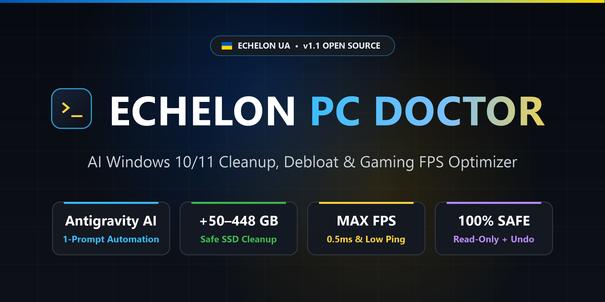
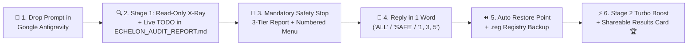

<div align="center">

<a href="https://github.com/abutnyak/echelon-pc-doctor">
  
</a>

# 🦅🇺🇦 ECHELON PC DOCTOR `v1.1`

### **Universal AI-Powered Windows 10/11 Audit, Cleanup, Debloat, Security & FPS Optimization System — For All PC Users & Gamers Worldwide**
*Created for players of **[Echelon UA — TOP SCUM Game Server by Medishe](https://www.echelon-scum.com/)** & the global PC / Gaming community*

[](https://github.com/abutnyak/echelon-pc-doctor/stargazers)
[](https://github.com/abutnyak/echelon-pc-doctor/commits/main)
[](https://www.echelon-scum.com/)
[-0078D6?style=for-the-badge&logo=windows&logoColor=white)](https://www.echelon-scum.com/)
[](https://antigravity.google/)
[](./ECHELON_PC_DOCTOR_UA.md)
[](#-why-echelon-pc-doctor-beats-traditional-cleaners--tweakers)
[-ff9900?style=for-the-badge)](./ECHELON_PC_DOCTOR_EN.md)
[](./LICENSE)
[](https://www.echelon-scum.com/)
[](https://savelife.in.ua/)

<br>

[](#-full-capabilities--feature-overview-14-engineering-modules)
[](#-full-capabilities--feature-overview-14-engineering-modules)
[](#-full-capabilities--feature-overview-14-engineering-modules)
[](#-full-capabilities--feature-overview-14-engineering-modules)
[](#-full-capabilities--feature-overview-14-engineering-modules)

---

**[⚡ 30-Sec Quick Start](#-quick-start-in-30-seconds--швидкий-старт-за-30-секунд) • [🇬🇧 English Docs](#-english-documentation) • [🇺🇦 Українська Інструкція](#-українська-інструкція) • [🔥 14 Engineering Modules](#-full-capabilities--feature-overview-14-engineering-modules) • [⚖️ Comparison](#-why-echelon-pc-doctor-beats-traditional-cleaners--tweakers) • [⏪ 1-Click Rollback](#-how-to-roll-back-everything-as-it-was-full-restore-in-1-minute) • [❓ FAQ](#-часті-питання-faq--frequently-asked-questions) • [🦅 Echelon UA Server](#-join-echelon-ua--top-scum-game-server-by-medishe)**

📄 **Prompt Files in this Repository:**
* 🇺🇦 **[`ECHELON_PC_DOCTOR_UA.md`](./ECHELON_PC_DOCTOR_UA.md)** — Full Ukrainian Edition (`v1.1`)
* 🇬🇧 **[`ECHELON_PC_DOCTOR_EN.md`](./ECHELON_PC_DOCTOR_EN.md)** — Full English Edition (`v1.1`)
*(💡 Both `_UA` and `_EN` files are 100% identical in functionality — either version will work on your PC, simply ask the AI agent to speak your preferred language! Supports all world languages except Russian, which is strictly blocked).*

⭐ **If this tool freed up gigabytes on your SSD or boosted your FPS — please give this repository a Star (⭐) at the top right and share it with your friends!**

</div>

---

## ⚡ Quick Start in 30 Seconds / Швидкий старт за 30 секунд

<table>
<tr>
<th align="left" width="50%">🇬🇧 English (3 Steps)</th>
<th align="left" width="50%">🇺🇦 Українською (3 кроки)</th>
</tr>
<tr>
<td valign="top">

1️⃣ Download & install free **[Google Antigravity](https://antigravity.google/)**.  
2️⃣ Click **`<> Code` ➔ `Download ZIP`** on this page, extract it, and open that folder in Antigravity (`File ➔ Open Folder`).  
3️⃣ Copy & paste this command into the AI chat on the right:

```text
Run ECHELON_PC_DOCTOR_EN.md
```

</td>
<td valign="top">

1️⃣ Встановіть безкоштовну програму **[Google Antigravity](https://antigravity.google/)**.  
2️⃣ Натисніть зелену кнопку **`<> Code` ➔ `Download ZIP`** вгорі сторінки, розпакуйте папку та відкрийте її в Antigravity (`File ➔ Open Folder`).  
3️⃣ Скопіюйте та вставте цю команду у вікно ШІ-чату праворуч:

```text
Виконай промпт із файлу ECHELON_PC_DOCTOR_UA.md
```

</td>
</tr>
</table>

---

# 🇬🇧 English Documentation

### 🚀 Turn Your PC or Laptop Into a High-FPS Machine — Safely, Transparently & For Free!

Most PCs lose **15–30% of their gaming performance** and **50–200+ GB of fast SSD space** over time due to hidden Windows bottlenecks, outdated duplicate driver repositories, background tray parasites, unoptimized BIOS/RAM settings, and shader cache stutters. Meanwhile, commercial "PC cleaners" (*CCleaner, Driver Booster*, etc.) only slow your system down with ads and telemetry.

**ECHELON PC DOCTOR (`v1.1`)** is a 100% universal engineering system prompt **specifically built, tested, and optimized for the free [Google Antigravity](https://antigravity.google/) AI environment** *(other AI tools with terminal access can also be used)*. Designed originally by the **Echelon UA** community, it works for **every Windows 10/11 desktop PC or laptop user in the world** — whether you are a **Gamer** (playing *CS2, S.T.A.L.K.E.R. 2, Dota 2, Rust, DayZ, Cyberpunk 2077, PUBG, Warzone, Fortnite, Battlefield*, or **SCUM**), a **Video Editor / 3D Artist**, a **Musician / Sound Engineer**, a **Software Developer**, or a **Home / Office PC user** (even if you have zero games installed!).

It transforms your AI agent into a **Senior Systems & Performance Engineer** that automatically adapts to your exact hardware (**Intel or AMD Ryzen / X3D CPUs**, **NVIDIA GeForce, AMD Radeon, or Intel Arc GPUs**) and installed software:

1. 🔍 **Stage 1 — 100% Safe Read-Only X-Ray:** Scans all drives, hardware buses, registry keys, startup sources, home LAN/Wi-Fi devices, and game settings **without deleting or changing a single byte**.
2. 🛡️ **"Do No Harm" & Full User Control (2-Turn Quick Menu):** Even with *"Always allow"* enabled, the agent **stops completely after the scan**, compresses healthy modules into 1 line, presents a 3-Tier Report (**🟢 Safe Junk**, **🟡 Your Choice**, **🔴 Hardware & Admin Tuning**), protects all personal files/saves/passwords, and gives you a **1-Line Quick-Reply Menu (`ALL`, `SAFE`, `1, 3, 5`, `ALL -2`)** saving up to **80% of AI tokens**!
3. ⚡ **Stage 2 — Autopilot Execution (`MEGA-BATCHING`) with System Restore & 1-Click Undo (`UNDO_RESTORE_DEFAULTS.bat`):** Automatically creates a **Windows System Restore Point, `.reg` backup, and a 1-click rollback script `C:\Echelon_Backup\UNDO_RESTORE_DEFAULTS.bat`** first, executes only what you approved in 1–2 master scripts, and generates a shareable **"Before / After Results Card"**!



### 🖥️ Real Verified Case Study: Full Multi-Stage Benchmark (`Intel Core Ultra 7 265K + MSI Z890 + RTX 4070 Ti + 64 GB DDR5`)

```text
╔════════════════════════════════════════════════════════════════════════════════════╗
║  🦅🇺🇦 ECHELON PC DOCTOR v1.1 — COMPLETE REAL-PC ENGINEERING CASE STUDY             ║
╠══════════════════════════════╦══════════════════════════╦══════════════════════════╣
║ Metric / Subsystem           ║ BEFORE (Initial State)   ║ AFTER (Full Optimization)║
╠══════════════════════════════╬══════════════════════════╬══════════════════════════╣
║ 💾 Reclaimed Local Disk Space║ 448.88 GB of Junk/Orphans║ +448.88 GB Freed on PC!  ║
║ 🚀 OS & SCUM NVMe Migration  ║ OS on old WD / SCUM SATA ║ 980 PRO NVMe + SCUM NVMe ║
║ 🧠 BIOS & 64GB DDR5 RAM Speed║ Old BIOS 1.A70 / 4800MHz ║ BIOS 1.AD0 + XMP 6000MHz ║
║ 🗂️ DriverStore & Installer DB║ 99 dupes + 61 MSI orphans║ -20.03 GB Cleaned Safely ║
║ 🦠 Malware & Cyber-Hygiene   ║ Infatica P2B + Lightshot ║ Botnet Killed / ShareX   ║
║ 🎮 GPU, VBS & Overlays       ║ HAGS Off / VBS On / Clash║ HAGS=2 / VBS Off / Reflex║
║ 🖱️ Kernel Timer & USB / Audio║ 12 USB sleeping / Ducking║ 0.5ms Timer / 0 USB Sleep║
║ 🌐 Killer 5GbE LAN & Ping    ║ IntMod=On / NetThrottle  ║ IntMod=0 / RSC & NB Off  ║
║ 🛡️ Windows Update Protection ║ Reinstalls Bloatware     ║ 5-Layer Shield Locked In ║
╚══════════════════════════════╩══════════════════════════╩══════════════════════════╝
```

---

## ⚖️ Why ECHELON PC DOCTOR Beats Traditional "Cleaners" & Tweakers

| Feature / Safety | ❌ Traditional Commercial "Cleaners" | ⚠️ Blind `.bat` Tweaker Scripts from YouTube | ✅ **ECHELON PC DOCTOR `v1.1` (AI Agent)** |
| :--- | :--- | :--- | :--- |
| **How it works** | Runs persistent background services, promotional pop-ups & telemetry | Blindly edits registry keys without checking your hardware | **Reads your exact hardware & OS first**, explains every finding |
| **User Control** | Deletes files behind a "Clean" button without details | All-or-nothing script that often breaks Windows features | **Human-in-the-Loop:** asks your permission for every critical action |
| **CPU & GPU Awareness** | None (generic rules across all CPUs/GPUs) | Applies generic tweaks that hurt **AMD Ryzen X3D** or laptops | Custom rules for **Intel P+E Cores, AMD Ryzen / Dual-CCD X3D, NVIDIA, Radeon & Intel Arc** |
| **Safety & Rollback** | Limited backup options | Often disables System Restore | Mandatory **Read-Only Stage 1 + System Restore Point + 1-Click `UNDO` Script** |
| **Price & Privacy** | Paid subscriptions, promotional bundles | Free, but risky | **100% Free, Open-Source (MIT), Zero Ads, Zero Telemetry** |

---

## 🔥 Full Capabilities & Feature Overview (14 Engineering Modules)

| # | Engineering Module | Complete List of Functions & What It Does for Your PC |
| :---: | :--- | :--- |
| **1** | **Storage Architecture, NVMe PCIe, `BypassIO` & NTFS Health** | • Audits all SSDs/HDDs (`HealthStatus`, temperature, wear, uncorrectable read/write errors, `Blackout & UPS Guard` write-cache check, `GPT` vs `MBR`, `FirmwareVersion` updates).<br>• Verifies NVMe PCIe Gen 3/4/5 link speed & width (`x4` vs throttled `x2`), **`NVMe D3Cold` deep-sleep guard (`StorNVMe`)**, Windows 11 **`DirectStorage / BypassIO`** (`fsutil bypassio state`), and checks if Windows is on your fastest SSD.<br>• Checks `4K` partition alignment, finds lost unallocated space, recovers **phantom missing NTFS gigabytes** (`chkdsk /f /x`), checks **`NTFS $UsnJrnl`** state (`fsutil usn queryjournal`), and removes accidental NTFS compression (blue arrows) using **16-thread parallel Win32 decompression**. |
| **2** | **Windows System Junk, `Windows.edb`, `DriverStore`, `Installer` & `pagefile.sys`** | • Cleans `%TEMP%`, Windows Update caches, `Windows.old`, crash dumps (decoding any recent **`BSOD / BugCheck`** causes first and blocking background **`WER` upload spikes**!), oversized `VSS` shadow copies, bloated **`Windows.edb` Search Index (10–40 GB)**, checks **`C:\Windows\Fonts` (`>1,000` font bloat)** & **`Pending Reboot Locks`**, and auto-heals system corruption (`DISM` + `SFC`).<br>• **Safe `DriverStore` & `C:\Windows\Installer` Deduplication:** removes superseded driver packages in `DriverStore\FileRepository` AND **orphaned `.msi / .msp` patches in `C:\Windows\Installer` (verified via `WindowsInstaller.Installer` COM DB — frees 10–40+ GB on `C:`!)**.<br>• **Universal Anti-Crash Memory Guard:** disables/reduces `hiberfil.sys` and places a `16 GB+` `pagefile.sys` on your fastest NVMe SSD to eliminate *Out of video memory / Fatal Error* crashes in all modern games (*SCUM, S.T.A.L.K.E.R. 2, Rust, DayZ, Cyberpunk 2077*)! |
| **3** | **Deep `AppData`, `ProgramData`, `NPU` & iPhone Backup Purge** | • Scans user profiles, lists TOP-15 space hogs, detects hidden **50–150 GB iPhone/iPad backups** (`Apple MobileSync\Backup`), and checks for overloaded `Desktop` folders / *OneDrive* sync traps.<br>• Purges multi-gigabyte shader/OTA/NPU caches (`NVIDIA OTA`, `D3DSCache`, `DXCache`, `Radeon DxCache/Dx9Cache/VkCache`, `Intel ShaderCache`, **`Intel Core Ultra NPU` / `Ryzen AI` compiled graphs**), installer caches (`Package Cache`), bloated Explorer **`thumbcache_*.db / iconcache_*.db` & `Jump Lists` (`AutomaticDestinations`)**, **`ConnectedDevicesPlatform` (`ActivitiesCache.db` tracking DB)**, and messenger media caches (*Telegram, Viber, Discord, Spotify*). |
| **4** | **All Installed Games Audit (with SCUM Sub-Context) & Pro Apps** | • **All Installed Games Inventory:** automatically detects **every game** across *Steam, Epic, Battle.net, EA, Ubisoft, GOG, Xbox, Riot* — checks drive placement (`NVMe` vs slow `HDD/SATA`), cleans old crash dumps across all engines (UE4/UE5/Unity) without touching saves, tames **`steamwebhelper.exe` (`800–1,500 MB RAM` idle drain)**, resolves **"Overlay Wars"**, **Dual-Vendor GPU Overlay Clashes (`iGPU vs dGPU Overlay`)** & Windows 11 `MPO` stutters, and includes a **dedicated SCUM sub-context** (deep `GameUserSettings.ini` audit: `DLSS Frame Generation` + `NVIDIA Reflex` sync, `SkeletalMeshLODBias`, `[ScalabilityGroups]` conflicts, VRAM pool + `EasyAntiCheat` & server-join crash recovery).<br>• **Creators & Devs:** finds hidden multi-GB caches in *Adobe Premiere/After Effects/CameraRaw*, *CapCut*, *DaVinci Resolve*, *Unreal Engine DDC*, duplicate *Cubase / Kontakt* sound libraries, and *Android Studio / JetBrains / Gradle / npm / Docker WSL2 `.vhdx` / Ollama AI* caches. |
| **5** | **Cyber-Hygiene 🚫, GitHub Open-Source 🐙 & `winget` 🔄** | • **Software Origin & Privacy Check 🚫:** informs the user about software and browser extensions originating from the Russian Federation jurisdiction (*Yandex, Kaspersky, Dr.Web, Lightshot, Punto Switcher, Zona, MediaGet, AIMP, Movavi, Reg Organizer, AdGuard*) and suggests global/Open-Source alternatives at the user's discretion.<br>• **Heavy Utilities $\rightarrow$ GitHub Open-Source 🐙:** suggests lightweight **GitHub Open-Source** alternatives (**BleachBit, BCUninstaller, qBittorrent, ShareX, 7-Zip, G-Helper**) for resource-heavy commercial utilities.<br>• **Freeware Auto-Updater & Zero-Judgment Principle 🔄:** updates **only free software** via official `winget` without touching or judging paid/modified software. |
| **6** | **Browser Speedup, SQLite `VACUUM` & Background VRAM Guard** | • Cleans gigabytes of browser caches (*Chrome, Edge, Brave, Opera, Firefox*) and on-device AI weights.<br>• Uses native Windows `winsqlite3.dll` (even without Python!) to purge expired tracking cookies (>30 days unvisited) and physically compact `History` & `Cookies` databases via SQL `VACUUM` while keeping all active logins & passwords intact.<br>• **Extension Permissions X-Ray & Game + Browser Map (`scum-map.com`) + Discord VRAM Guard:** audits `manifest.json` for `<all_urls>` / `cookies` access and optimizes browser `Sleeping Tabs` and Discord Hardware Acceleration to save **1–1.8 GB VRAM** on 6–8 GB GPUs! |
| **7** | **UWP Debloat, Windows 11 Parasites & Anti-Resurrection Shield** | • Audits all removable Microsoft Store apps by disk size and **last active date**, while protecting `Xbox/GamingServices` and hardware codecs (`HEVC, VP9, AV1`).<br>• **5-Layer Anti-Resurrection Shield (Anti-Windows Update Bloatware):** uses `Remove-AppxProvisionedPackage -Online` (`Deprovisioned` tombstones), locks `DisableWindowsConsumerFeatures = 1` & `SilentInstalledAppsEnabled = 0`, blocks **OneDrive (`DisableFileSyncNGSC = 1`)**, **Copilot (`TurnOffWindowsCopilot = 1`)**, **Windows Recall (`DisableAIDataAnalysis = 1`)**, **Widgets (`AllowNewsAndInterests = 0`)**, Start Menu `Bing Web Search`, **`DiagTrack` telemetry (`ETLLogs`)**, and deletes `UScheduler_Oobe` (`DevHomeUpdate` / `OutlookUpdate`) so Windows Updates never reinstall bloatware! |
| **8** | **`Downloads`, TOP-20 Monster Files & Replay Buffers** | • Lists the **TOP-20 largest individual files (> 2–5 GB)** across all drives and forgotten installers in `Downloads`.<br>• Detects **duplicate background video recorders** (`SteelSeries Moments / Medal / Outplayed` running alongside `ShadowPlay / ReLive` + `SteelSeriesGGEZ`) and decodes binary registry paths (`TempFilePath` / `DefaultPathW` in `NVSPCAPS`) so continuous **Instant Replay** buffers never write to a slow mechanical HDD or wear out your OS/game SSD. |
| **9** | **Deep Windows Registry Cleanup (with `.reg` Backup)** | • Exports automatic `.reg` backups before cleaning.<br>• Removes orphaned keys of uninstalled software/adware, hundreds of dead `Installer\Folders` paths, **broken `.lnk` shortcuts (`Desktop` / `Start Menu`), missing app `InstallLocation` paths after drive/folder moves (`winget --force` repair), and dead `PATH` environment variable entries**, thousands of accumulated dead `Audio\PolicyConfig\PropertyStore` sessions (fixing slow audio startup), broken Windows Firewall rules, and audits the **Windows Explorer 15-Slot Icon Overlay Limit (`ShellIconOverlayIdentifiers`)** so *OneDrive/Adobe* don't break `Git / TortoiseGit` status icons. |
| **10** | **RAM Leaks, `Standby RAM`, Thermal Throttling & Smart CPU Tuning** | • Checks `Non-Paged Pool` kernel leaks, **Process Handle Leaks (`> 15,000 Handles`)**, **`Windows 11 Dynamic Lighting (LampArray)` vs RGB / DDR5 `SMBus` polling stutters**, cached **`Standby RAM`**, smart **`MemoryCompression` (`Get-MMAgent`)**, disables the `Fast Startup` (`HiberbootEnabled`) kernel uptime trap, detects **CPU/GPU Thermal & Power Limit Throttling** (`Event ID 37` / dried thermal paste), and disables `PCIe ASPM`.<br>• **Smart CPU Core Parking & Hybrid `P+E` Cores:** preserves `3D V-Cache` CCD1 parking on dual-CCD **AMD Ryzen 7900X3D / 7950X3D / 9950X3D** (preventing a 15–25% FPS loss!), unparks 100% of cores (`CPMINCORES = 100%`) on single-CCD Ryzen and Intel CPUs, and verifies `Heterogeneous policy` so Windows 11 keeps game threads on fast Intel `P-Cores` rather than slow `E-Cores`. |
| **11** | **5-Level Antivirus/Anti-Miner Radar, Autostart X-Ray & Home Wi-Fi/LAN Security** | • **🦠 5-Level Antivirus & Anti-Miner Scanner:** audits **suspicious Windows Defender Exclusions** (`Get-MpPreference`), catches **fake system processes** (`svchost.exe` outside `System32`) & **`.lnk` Shortcut Hijacks**, verifies digital signatures (`Get-AuthenticodeSignature`), **`catroot2` cryptographic DB bloat**, & **injected `LocalMachine\Root` MITM certificates**, scans mining pool ports (`3333/4444/14444`), WMI fileless malware, P2B proxy botnets (`Infatica P2B`), duplicate **`Microsoft GameInput (`GameInputSvc`)` service conflicts**, and performs a **Forensic AppCrash Autopsy (`Event ID 1000`)**.<br>• **6-Source Startup X-Ray:** scans `Run`, `WOW6432Node`, Task Manager `StartupApproved`, UWP `StartupTasks`, Task Scheduler `AtLogOn`, and `Edge Startup Boost` — safely disabling tray apps eating **1.5–4 GB RAM**.<br>• **Home Network, `WinNAT` Port Blocks, `NetBIOS` / `Ndu.sys` & Wi-Fi Security Radar:** checks **Ethernet Cable link speed** (`100 Mbps` bottleneck vs `1–2.5 Gbps`) or **Wi-Fi band & encryption** (`2.4 GHz` lag vs `5/6 GHz`, `WPA2/WPA3`), checks `WinNAT / Hyper-V ExcludedPortRange` UDP/TCP blocks, disables legacy **`NetBIOS over TCP/IP` (`TcpipNetbiosOptions = 2`)**, checks `Cloudflare WARP / VPN` tunnel `MTU` (`NlMtu`), runs a **2-Hop `PC ➔ Router ➔ ISP` Latency Test**, lists **all active devices connected to your router**, checks for **ARP-Spoofing (MITM)**, exposed `RDP 3389` / background `AnyDesk 7070` daemons, & benchmarks live DNS in ms (`1.1.1.1` / `8.8.8.8` / `9.9.9.9`). |
| **12** | **WHQL Hardware Driver Currency Audit (Intel & AMD + Live NVIDIA API)** | • Queries **NVIDIA's official live JSON API (`gfwsl.geforce.com`)** directly in Stage 1 to detect new `Game Ready / Studio` WHQL drivers on release day, and audits **AMD Chipset Software / 3D V-Cache Optimizer** or **Intel Chipset / ME / IPF**, **AMD Adrenalin / Intel Arc**, ASIO/Realtek Audio, LAN/Wi-Fi/Bluetooth, and NVMe controllers. |
| **13** | **BIOS Currency (Microcode / AGESA), Cold-Boot `FwPOSTTime` & XMP / EXPO RAM** | • Checks motherboard BIOS against the manufacturer's support site (critical for Intel 13/14th Gen `0x12B` microcode & AMD AGESA `fTPM Stutter` / safe `SoC` voltage fixes), verifies active loaded CPU `Update Revision`, and measures **`BIOS POST Time` (`FwPOSTTime` — recommending `Memory Context Restore` if boot takes >15–20s)**.<br>• Verifies Dual-Channel operation and warns if fast DDR4/DDR5 RAM is stuck at base JEDEC speed (`2133 / 4800 MHz`) instead of full **Intel XMP / AMD EXPO / DOCP** frequency (`3200–3600 / 6000+ MHz`). |
| **14** | **Esports FPS for All Games & SCUM, GPU, `48 kHz` Audio, Mic & Ping** | • **Universal GPU & Monitor Tuning:** verifies PCIe link width, **`12VHPWR / Power Brake` throttle flags**, & `Resizable BAR / AMD SAM`, disables Radeon `ULPS` stutter (`EnableUlps = 0`), expands GPU Shader Cache (`NVIDIA 10–100 GB` / `Radeon Always On`), checks **`NVIDIA CUDA P2 State` VRAM downclocking** & **`NVIDIA Ansel (NvCamera)` hooks**, binds the `.exe` of **all installed games** (`SCUM.exe`) to the discrete GPU, checks monitor PCI parent (`DEVPKEY_Device_Parent`) & mixed-Hz `dwm.exe` composition, sets **`Full RGB (0–255)`**, warns against the **`Windows 11 Auto HDR` NVG Glare Trap**, and eliminates the 3-second black screen on `Alt + Tab`.<br>• **FPS, `KernelShadowStacks`, `GlobalTimerResolutionRequests`, `SFIO Priority`, `StickyKeys`, Per-Device USB Sleep & `xHCI` MSI Mode:** checks Windows 11 `VBS / HVCI` & **`KernelShadowStacks`** (**+5–15% FPS**), restores global `0.5 ms` kernel timer synchronization (**`GlobalTimerResolutionRequests = 1`**), sets **`MMCSS SFIO Priority = High`** for instant NVMe texture streaming, disables `Xbox GameDVR`, **`StickyKeys (5x Shift)`** pop-ups, and **per-device USB registry sleep (`EnhancedPowerManagementEnabled = 0`)**, enables `HAGS`, `MSI Mode` (including **`USB xHCI Host Controllers`**), `DirectX Flip Model`, `VRR (G-SYNC / FreeSync)`, and checks `Virtual HID / vJoy` gamepad aim-stutter conflicts & `4000/8000 Hz` mouse polling CPU spikes.<br>• **Footsteps, Anti-Ducking, Unused Audio Zoo, Microphone & Ping:** verifies stereo audio (anti-mono), native **`48 kHz / 24-bit`** sample rate, cleans up the **"Unused Audio Driver Zoo"** (`nvhda64v.sys` on speakerless monitors), disables Windows **Audio Ducking (`UserDuckingPreference = 3`)** so Discord voice chat never lowers game footstep volume by 80%, protects **Microphone `Exclusive Mode`**, removes `NetworkThrottlingIndex` limits, verifies **`TCP Auto-Tuning = Normal`**, disables **`Receive Segment Coalescing` (`Disable-NetAdapterRsc`)** & NIC `Interrupt Moderation = 0`, checks `Ghost NICs`, and adds all game & anti-cheat folders to Defender exclusions. |

---

## 🛠️ Step-by-Step Guide (Easy for Beginners & Pros — Takes 2 Minutes)

Even if you have never used GitHub or AI tools before, just follow these **5 simple steps**:

1. **📥 Step 1 — Install Google Antigravity & Pick the Right Model:**
   Go to 👉 **[https://antigravity.google/](https://antigravity.google/)**, click **Download**, install the program (just like any regular app), and sign in with your regular Google / Gmail account.
   * 🧠 **Which AI Model Should You Select in the Chat Dropdown?**
     * 💎 **If you have a PAID Subscription (Google Gemini Advanced / Google One AI Pro):** select **`Gemini 4 (Argon / Pro)`** — Google's flagship reasoning model, which will run all 14 modules in a single pass with maximum analytical depth!
     * 🆓 **If you are on the FREE Tier (No Subscription):** select **`Gemini Flash` (`Gemini 3.8 Flash`)** — thanks to the built-in **Module-by-Module `TODO` Pipeline in `ECHELON_AUDIT_REPORT.md`**, the agent analyzes your PC sequentially (1 module or compact focus-group at a time), writes found tasks directly into the `TODO` file on disk so it never loses context or hits output limits, and lets you resume from the exact next module at any time!
2. **📂 Step 2 — Download the Prompt File from GitHub to a Folder on Your PC:**
   * **Easiest way (Download ZIP):** At the top right of this GitHub page, click the green **`<> Code`** button $\rightarrow$ **`Download ZIP`**, and extract the folder anywhere on your PC (e.g., to your Desktop or `C:\PC_Optimization`).
   * **Or download just 1 file:** Click on **[`ECHELON_PC_DOCTOR_EN.md`](./ECHELON_PC_DOCTOR_EN.md)** in the file list above, click the **⬇️ (`Download raw file`)** icon at the top right of the file view, and save it into an empty folder on your PC *(🌍 Note: either `_EN` or `_UA` file works identically — we warmly welcome users from all around the free world and gladly support every language on Earth except Russian, because Russia is a terrorist state that violates international law 🚫)*.
3. **🖥️ Step 3 — Open the Folder in Google Antigravity:**
   Launch **Google Antigravity**, click **File $\rightarrow$ Open Folder...** in the top-left menu, and select the folder where you saved the file *(if asked "Do you trust the authors of the files in this folder?", click **Yes, I trust the authors**)*.
4. **🚀 Step 4 — Start the Safe Scan in the AI Chat (Stage 1):**
   In the AI chat panel on the right *(if the chat panel isn't visible, press `Ctrl + L` or click the AI chat icon at the top right)*, type:
   * **Standard Run (works on both Paid Pro and Free `Gemini Flash`):**
     ```text
     Run ECHELON_PC_DOCTOR_EN.md
     ```
   * **Ultra-Light 1-Module-at-a-Time Mode (optional for strict Free Tier quotas):**
     ```text
     Run ECHELON_PC_DOCTOR_EN.md module by module (1 module at a time) and save tasks to ECHELON_AUDIT_REPORT.md
     ```
   * 📄 **Live Module-by-Module `TODO` Tracker & Cross-Session Journal (`ECHELON_AUDIT_REPORT.md` — Zero Context or Progress Lost):** Right from Step 0, the agent creates **`ECHELON_AUDIT_REPORT.md`** with a `[ ] Module 1 .. [ ] Module 14` progress tracker and an **`ACTION TODO LIST`**. As it inspects each module, it immediately writes discovered optimizations to the `TODO` list on disk and checks off `[x] Module N`. If your free token quota runs out mid-scan or you reboot your PC / configure BIOS, simply open a new chat and type: **`Continue from ECHELON_AUDIT_REPORT.md`** — the agent will read the file and continue from the first uncompleted `[ ] Module` without repeating anything!
   * 💡 **IMPORTANT PRO TIP (Zero Click Spam):** When the agent asks permission to run its first terminal check, click the small arrow **`▼`** next to the **Allow / Run** button and select **"Always allow"**. The agent will finish the entire Read-Only scan in 1–2 minutes and **stop completely** to show you the report!
5. **⚡ Step 5 — Reply in 1 Word, Run the Admin File & Type `+` / `DONE` in Chat (Stages 2 & 3):**
   * At the bottom of the report, the agent will show a numbered menu `[1]`, `[2]`, `[3]`... Simply reply in chat with **`ALL`** (to apply all recommended optimizations), **`SAFE`** (only 100% safe junk cleanup), or specific numbers like **`1, 3, 5`**.
   * When the agent generates the final **`echelon_doctor_admin.bat`** file in your folder, open that folder in Windows Explorer and **right-click `echelon_doctor_admin.bat` $\rightarrow$ "Run as administrator"**.
   * 💬 **Don't close the chat yet!** As soon as the `.bat` window finishes, **return to the chat and type `+` or `DONE`** (and answer the agent's follow-up questions!) — the agent will verify that all tweaks applied properly, delete temporary `.bat` files, generate your **"Before / After Results Card"**, and help you fine-tune your in-game graphics or BIOS settings! *(📱 **Pro Tip:** if you need to reboot your PC or enter BIOS — **take a photo of the instructions on your phone** before restarting!).* 🎉

---

## ⏪ How to Roll Back "Everything As It Was" (Full Restore in 1 Minute)

Before changing a single setting on Stage 2, the AI agent automatically saves all your original states into **`C:\Echelon_Backup`** (registry `.reg` exports, startup state manifest, game `.ini.bak` configs, browser `Cookies.bak`) and creates a Windows System Restore Point. If you ever do something wrong or want to revert your PC back to its exact original state, you have **3 effortless ways**:

1. **🖱️ Method 1 — 1-Click Undo Script (`UNDO_RESTORE_DEFAULTS.bat`):**
   Open the folder **`C:\Echelon_Backup`**, right-click **`UNDO_RESTORE_DEFAULTS.bat` $\rightarrow$ "Run as administrator"**, and reboot your PC. It automatically restores your original registry keys, startup apps, network settings, power plan, and `VBS/HVCI` state!
2. **💬 Method 2 — Ask the AI Agent in Chat:**
   Simply type in the **Google Antigravity** chat:
   ```text
   Restore all settings as they were from C:\Echelon_Backup
   ```
   The agent will automatically read your saved backups and revert every change for you.
3. **🛡️ Method 3 — Windows System Restore Point (Built-in OS Rollback):**
   Press **`Win + R`** on your keyboard, type **`rstrui.exe`**, press **Enter**, and select the **`Before_Echelon_PC_Doctor`** restore point created right before Stage 2.

---
---

# 🇺🇦 Українська Інструкція

### 🚀 Перетвори свій ПК або ноутбук на ракету — безпечно, прозоро та безкоштовно!

Більшість комп'ютерів із часом втрачають **15–30% ігрового FPS** та **від 50 до 200+ ГБ швидкого місця на SSD** через приховані системні обмеження Windows, десятки гігабайтів старих дублікатів драйверів, програми-паразити в автозавантаженні, неправильні налаштування BIOS/оперативки та мікрофрізи під час компіляції шейдерів. А популярні «оптимізатори» з інтернету (*CCleaner, Driver Booster* тощо) лише добивають систему рекламою та фоновою телеметрією.

**ECHELON PC DOCTOR (`v1.1`)** — це на 100% універсальний інженерний системний промпт, **спеціально розроблений, протестований та оптимізований для безкоштовного ШІ-середовища [Google Antigravity](https://antigravity.google/)** *(також можна використовувати інші ШІ-інструменти з доступом до термінала)*. Створений спільнотою **Echelon UA**, він ідеально підходить **для абсолютно кожного власника ПК або ноутбука на Windows 10/11** — незалежно від того, чи ви **Геймер** (граєте в *CS2, S.T.A.L.K.E.R. 2, Dota 2, Rust, DayZ, Cyberpunk 2077, PUBG, Warzone, Fortnite, Battlefield* або **SCUM**), **Відеомонтажер / 3D-дизайнер**, **Музикант / Звукорежисер**, **Програміст**, чи просто хочете почистити та прискорити свій **домашній / робочий ноутбук** (навіть якщо на ньому взагалі немає ігор!).

Промпт перетворює ШІ-агента на вашого персонального **Senior-інженера з системної архітектури та швидкодії**, який автоматично підлаштовується під ваше залізо (**процесори Intel або AMD Ryzen / X3D**, **відеокарти NVIDIA GeForce, AMD Radeon або Intel Arc**) та встановлені програми:

1. 🔍 **Етап 1 — 100% Безпечний рентген системи (Read-Only):** сканує всі диски, лінії PCIe, реєстр, автостарт, домашню мережу (Кабель / Wi-Fi / пристрої на роутері) та ігрові налаштування, **не видаляючи і не змінюючи жодного байта без вашого відома**.
2. 🛡️ **Доктрина «Не нашкодь» та Меню Коротких Команд (Економія до 80% токенів):** навіть при увімкненому режимі *«Always allow»* агент **повністю зупиняється після сканування**, стискає справні модулі в 1 рядок, формує звіт у 3 категоріях (**🟢 100% Безпечне сміття**, **🟡 На ваш вибір**, **🔴 Драйвери та Турбо-тюнінг**) і дає **меню відповідей одним словом (`ВСЕ`, `БАЗА`, `1, 3, 5`, `ВСЕ крім 2`)** без довгих переписок!
3. ⚡ **Етап 2 — Автопілот (`MEGA-BATCHING`) із Точкою відновлення та Кнопкою Відкату (`UNDO_RESTORE_DEFAULTS.bat`):** перед змінами автоматично створює **точку відновлення системи Windows, бекап реєстру `.reg` та готовий файл відкату в 1 клік `C:\Echelon_Backup\UNDO_RESTORE_DEFAULTS.bat`**, виконує лише схвалені вами пункти об'єднаним скриптом і генерує фінальну **«Картку Результатів До / Після»**!

### 🖥️ Реальний верифікований кейс: Повний результат оптимізації ПК (`Intel Core Ultra 7 265K + MSI Z890 + RTX 4070 Ti + 64 GB DDR5`):

```text
╔════════════════════════════════════════════════════════════════════════════════════╗
║  🦅🇺🇦 ECHELON PC DOCTOR v1.1 — ПОВНИЙ РЕАЛЬНИЙ КЕЙС ДО / ПІСЛЯ                     ║
╠══════════════════════════════╦══════════════════════════╦══════════════════════════╣
║ Показник / Підсистема        ║ ДО ОПТИМІЗАЦІЇ           ║ ПІСЛЯ ОПТИМІЗАЦІЇ        ║
╠══════════════════════════════╬══════════════════════════╬══════════════════════════╣
║ 💾 Звільнено місця на ПК     ║ 448.88 ГБ сміття й дублів║ +448.88 ГБ чистого місця!║
║ 🚀 Міграція ОС та гри SCUM   ║ ОС на WD / SCUM на SATA  ║ 980 PRO NVMe + SCUM NVMe ║
║ 🧠 Прошивка BIOS та ОЗП DDR5 ║ Старий 1.A70 / 4800 МГц  ║ BIOS 1.AD0 + XMP 6000МГц ║
║ 🗂️ DriverStore та Installer  ║ 99 дублів + 61 патч-сирот║ -20.03 ГБ безпечно знято ║
║ 🦠 Віруси та Кібергігієна    ║ Ботнет Infatica+Lightshot║ Ботнет знищено / ShareX  ║
║ 🎮 Відеокарта, VBS та Оверлеї║ HAGS Вимк / VBS / Конфл. ║ HAGS=2 / VBS Вимк /Reflex║
║ 🖱️ Таймер ядра, USB та Звук  ║ 12 USB спали / Приглуш.  ║ 0.5ms Таймер / 0 сну USB ║
║ 🌐 Мережа Killer 5GbE і Пінг ║ IntMod=On / NetThrottle  ║ IntMod=0 / RSC та NB Off ║
║ 🛡️ Захист від сміття Windows ║ Відкритий до апдейтів    ║ 5-Рівневий Щит HKLM!     ║
╚══════════════════════════════╩══════════════════════════╩══════════════════════════╝
```

---

## ⚖️ Чому ECHELON PC DOCTOR кращий за традиційні «очищувачі» та твікери

| Критерій / Безпека | ❌ Традиційні комерційні «очищувачі» | ⚠️ Сліпі `.bat`-твікери з YouTube / Форумів | ✅ **ECHELON PC DOCTOR `v1.1` (ШІ-Інженер)** |
| :--- | :--- | :--- | :--- |
| **Принцип роботи** | Тримають фонові служби, рекламні банери та телеметрію | Наосліп змінюють реєстр, не знаючи вашого заліза | **Спочатку вивчає саме ваше залізо та ОС** і пояснює кожен пункт |
| **Контроль користувача** | Ховає деталі за однією кнопкою «Очистити» | Принцип «усе або нічого», часто ламає служби Windows | **Human-in-the-Loop:** запитує ваш дозвіл щодо кожного важливого рішення |
| **Врахування CPU та GPU** | Ніякого (однакові правила для всіх ПК) | Шаблонні твіки, які ріжуть FPS на **Ryzen X3D** чи ноутбуках | Індивідуальні правила під **Intel P+E Cores, AMD Ryzen / Dual-CCD X3D, NVIDIA, Radeon та Intel Arc** |
| **Безпека та відкат** | Обмежені можливості бекапу | Часто вимикає точки відновлення системи | Обов'язковий **Read-Only Етап 1 + Точка відновлення + Скрипт `UNDO` в 1 клік** |
| **Ціна та приватність** | Платні підписки, рекламні пропозиції | Безкоштовно, але на власний страх і ризик | **100% Безкоштовно, Open-Source (MIT), 0 реклами, 0 телеметрії** |

---

## 🔥 Що вміє ця система — Повний огляд усіх функцій (14 інженерних модулів)

| # | Інженерний модуль | Повний опис функцій та що це дає вашому ПК |
| :---: | :--- | :--- |
| **1** | **Архітектура дисків, шина NVMe PCIe, `BypassIO` та здоров'я NTFS** | • Повна перевірка всіх SSD та HDD (`HealthStatus`, температура, знос, невиправні помилки читання/запису, захист кешу запису від блекаутів `Blackout & UPS Guard`, `GPT` чи `MBR`, актуальність прошивки `FirmwareVersion`).<br>• Контроль реальної швидкості ліній NVMe PCIe Gen 3/4/5 (`x4` чи урізаний `x2`), **захист від глибокого сну `NVMe D3Cold` (`StorNVMe`)**, перевірка прямого каналу **`DirectStorage / BypassIO`** (`fsutil bypassio state`) у Windows 11 та чи стоїть ОС на найшвидшому диску.<br>• Перевірка вирівнювання розділів `4K`, пошук втрачених нерозподілених гігабайтів, миттєве повернення **«фантомно зниклого» місця NTFS** (`chkdsk /f /x`), перевірка журналу змін **`NTFS $UsnJrnl`** (`fsutil usn queryjournal`) та зняття випадкового стиснення NTFS (синіх стрілок) у **16 потоків через Win32 API**. |
| **2** | **Системне сміття Windows, `Windows.edb`, `DriverStore`, `Installer` та `pagefile.sys`** | • Очищення `%TEMP%`, кешів оновлень Windows, `Windows.old`, дампів падінь (із попередньою розшифровкою причин «Синіх екранів» **`BSOD / BugCheck`** та блокуванням фонового вивантаження дампів **`WER`** під час гри!), роздутих тіньових копій `VSS`, роздутої бази пошуку **`Windows.edb` (10–40 ГБ)**, перевірка перевантаження шрифтів **`C:\Windows\Fonts` (`>1,000` шрифтів)** і **`Pending Reboot Locks`**, та авто-лікування системних файлів (`DISM` + `SFC`).<br>• **Безпечна дедуплікація `DriverStore` та `C:\Windows\Installer`:** видаляє старі дублікати пакетів драйверів у `DriverStore\FileRepository` ТА **100% осиротілі патчі `.msi / .msp` у `C:\Windows\Installer` (звірені через COM-базу `WindowsInstaller.Installer` — звільняє 10–40+ ГБ на диску `C:`!)**.<br>• **Захист усіх сучасних ігор та SCUM від вильотів по пам'яті:** вимикає/стискає `hiberfil.sys` і налаштовує `pagefile.sys` (`16 ГБ+` виключно на швидкому NVMe SSD), що повністю прибирає вильоти *Out of video memory / Fatal Error* у сучасних іграх (*SCUM, S.T.A.L.K.E.R. 2, Rust, DayZ, Cyberpunk 2077*)! |
| **3** | **Очищення `AppData`, `ProgramData`, кешу `NPU` та бекапів iPhone** | • Сканує профілі користувачів, знаходить ТОП-15 найбільших папок, виявляє приховані **бекапи iPhone/iPad на 50–150 ГБ** (`Apple MobileSync\Backup`) та перевіряє перевантаженість Робочого столу (`Desktop`) / пастку синхронізації *OneDrive*.<br>• Вичищає багатогігабайтні кеші шейдерів, апдейтерів та нейропроцесорів (`NVIDIA OTA`, `D3DSCache`, `DXCache`, `Radeon DxCache/Dx9Cache/VkCache`, `Intel ShaderCache`, **скомпільовані графи `Intel Core Ultra NPU` / `Ryzen AI`**), інсталяційні кеші (`Package Cache`), роздуті бази ескізів Провідника **`thumbcache_*.db / iconcache_*.db` та `Jump Lists` (`AutomaticDestinations`)**, **базу стеження `ConnectedDevicesPlatform` (`ActivitiesCache.db`)** та медіа-кеші месенджерів (*Telegram, Viber, Discord, Spotify*). |
| **4** | **Аудит УСІХ встановлених ігор (із спец-підконтекстом SCUM) та Проф-софту** | • **Інвентаризація всіх ігор на ПК:** автоматично знаходить **усі встановлені ігри** (*Steam, Epic, Battle.net, EA, Ubisoft, GOG, Xbox, Riot*) — перевіряє диск встановлення (`NVMe` чи повільний `HDD/SATA`), чистить краш-логи всіх рушіїв (UE4/UE5/Unity) без ризику для збережень, приборкує апетит **`steamwebhelper.exe` (`800–1,500 МБ RAM` у простої)**, усуває **«Війну оверлеїв»**, **конфлікти оверлеїв двох GPU (`iGPU vs dGPU Overlay`)** і баг `MPO` у Windows 11 та має **спеціальний підконтекст для SCUM** (глибокий рентген `GameUserSettings.ini`: зв'язка `DLSS Frame Generation` + `NVIDIA Reflex`, чіткість гравців `SkeletalMeshLODBias`, конфлікти `[ScalabilityGroups]`, ліміт VRAM + реанімація `EasyAntiCheat`).<br>• **Для Монтажерів, Музикантів та Розробників:** знаходить приховані гігантські кеші *Adobe Premiere/After Effects/CameraRaw*, *CapCut*, *DaVinci Resolve*, *Unreal Engine DDC*, дублікати бібліотек *Cubase / Kontakt*, а також кеші *Android Studio / JetBrains / Gradle / npm / Docker WSL2 `.vhdx` / локальних ШІ-моделей Ollama*. |
| **5** | **Кібергігієна 🚫, Open-Source з GitHub 🐙 та `winget` 🔄** | • **Інформування про походження ПЗ 🚫:** інформує користувача про програми та розширення браузерів походженням із юрисдикції рф (*Yandex, Kaspersky, Dr.Web, Lightshot, Punto Switcher, Zona, MediaGet, AIMP, Movavi, Reg Organizer, AdGuard*) і за бажанням користувача пропонує світові/Open-Source аналоги.<br>• **Легкі Open-Source аналоги з GitHub 🐙:** пропонує за вибором користувача замінити ресурсоємні утиліти на легкі відкриті програми з GitHub (**BleachBit, BCUninstaller, qBittorrent, ShareX, 7-Zip, G-Helper**).<br>• **Авто-оновлення безкоштовних програм та Принцип без осуду 🔄:** оновлює **лише безкоштовний софт** через офіційний `winget`, не чіпаючи і не засуджуючи платні чи модифіковані програми. |
| **6** | **Прискорення браузерів, стиснення SQLite `VACUUM` та захист VRAM** | • Очищує гігабайти файлового кешу браузерів (*Chrome, Edge, Brave, Opera, Firefox*) та локальні ШІ-моделі.<br>• Напряму через системну бібліотеку Windows `winsqlite3.dll` (навіть без встановленого Python!) видаляє сміттєві трекінгові кукі сайтів, на які ви не заходили понад 30 днів, і фізично стискає бази `History` та `Cookies` командою `VACUUM`, зберігаючи всі ваші логіни й паролі.<br>• **Рентген дозволів розширень (`manifest.json`) та Захист VRAM при відкритих «Гра + Карта (`scum-map.com`) + Discord»:** перевіряє розширення з доступом до всіх сайтів (`<all_urls>`, `cookies`) та оптимізує `Sleeping Tabs` у браузері й апаратне прискорення Discord, звільняючи **1–1.8 ГБ відеопам'яті** на картах із 6–8 ГБ VRAM! |
| **7** | **Очищення UWP-сміття, паразитів Windows 11 та Щит від повернення** | • Аналізує стандартні програми Windows за розміром та **датою останнього запуску**, гарантовано зберігаючи ігрові служби (`Xbox/GamingServices`) та відеокодеки (`HEVC, VP9, AV1`).<br>• **5-Рівневий Щит від повернення сміття після оновлень Windows Update:** видаляє образи через `Remove-AppxProvisionedPackage -Online` (створюючи блокіратори `Deprovisioned`), вмикає політики `DisableWindowsConsumerFeatures = 1` та `SilentInstalledAppsEnabled = 0`, назавжди блокує **OneDrive (`DisableFileSyncNGSC = 1`)**, **Copilot (`TurnOffWindowsCopilot = 1`)**, **Windows Recall (`DisableAIDataAnalysis = 1`)**, **Віджети (`AllowNewsAndInterests = 0`)**, пошук `Bing` у Пуску, службу телеметрії **`DiagTrack` (`ETLLogs`)** та видаляє тригери `UScheduler_Oobe` (`DevHomeUpdate` / `OutlookUpdate`), щоб оновлення Windows ніколи не повернули сміттєвий софт! |
| **8** | **Ревізія `Downloads`, ТОП-20 файлів-монстрів та буфера запису** | • Виводить список **ТОП-20 найбільших окремых файлів (> 2–5 ГБ)** по всіх дисках та забутих інсталяторів у `Downloads`.<br>• Виявляє **подвійний прихований відеозапис екрана** (`SteelSeries Moments / Medal / Outplayed` паралельно з `ShadowPlay / ReLive` + рекламний `SteelSeriesGGEZ`) та розшифровує бінарні шляхи реєстру (`TempFilePath` / `DefaultPathW` у `NVSPCAPS`), щоб буфер миттєвого повтору (*Instant Replay*) не писався на повільний механічний HDD і не зношував диск із системою або грою. |
| **9** | **Глибоке очищення реєстру Windows (із бекапом `.reg`)** | • Обов'язково створює резервну копію `.reg` перед будь-яким очищенням.<br>• Видаляє осиротілі гілки давно видалених програм та Adware, сотні мертвих шляхів інсталяторів у `Installer\Folders`, **перевіряє «биті» ярлики `.lnk` (Робочий стіл і меню «Пуск»), зниклі після перенесення папок чи дисків програми (`Uninstall\InstallLocation` з відновленням через `winget --force`) та мертві шляхи у змінній `PATH`**, тисячі накопичених мертвих аудіосесій у `Audio\PolicyConfig\PropertyStore` (які гальмують звук), биті правила Брандмауера та перевіряє **ліміт 15 слотів іконок-оверлеїв Провідника (`ShellIconOverlayIdentifiers`)**, щоб *OneDrive/Adobe* не ламали іконки статусу в `Git / TortoiseGit`. |
| **10** | **Оперативна пам'ять, `Standby RAM`, Тротлінг та тюнінг CPU** | • Перевіряє витоки ядра `Non-Paged Pool`, **витоки дескрипторів (`Process Handle Leaks > 15,000 Handles`)**, **конфлікт підсвітки `Windows 11 Dynamic Lighting (LampArray)` із RGB-софтом та шиною `SMBus` пам'яті DDR5**, кешовану **`Standby RAM`**, статус стиснення пам'яті **`MemoryCompression` (`Get-MMAgent`)**, вимикає пастку `Fast Startup` (`HiberbootEnabled`), діагностує **перегрів та скидання частот CPU/GPU** (`Event ID 37` / висохла термопаста) і вимикає `PCIe ASPM`.<br>• **Розумне керування ядрами CPU та гібридні `P+E` ядра:** зберігає правильне паркування другого чіплета на двочіплетних **AMD Ryzen 7900X3D / 7950X3D / 9950X3D** для максимальної роботи `3D V-Cache` (захищаючи від втрати 15–25% FPS!), розпарковує 100% ядер (`CPMINCORES = 100%`) на одночіплетних Ryzen та Intel, і перевіряє `Heterogeneous policy`, щоб ігрові потоки SCUM працювали на швидких `P-ядрах` замість повільних `E-ядер`. |
| **11** | **5-Рівневий Антивірус/Анти-Майнер, Автостарт (6 джерел) та Домашня мережа** | • **🦠 5-Рівневий Антивірусний та Анти-Майнер Дефектоскоп:** викриває **підозрілі виключення Windows Defender** (`Get-MpPreference`), ловить **процеси-перевертні** (`svchost.exe` поза `System32`) та **підміну ярликів `.lnk`**, перевіряє цифрові підписи (`Get-AuthenticodeSignature`), **базу криптокаталогів `catroot2`** і **підсаджені кореневі сертифікати `LocalMachine\Root` (`MITM`)**, порти майнінг-пулів (`3333/4444/14444`), безфайлові WMI-віруси, проксі-ботнети (`Infatica P2B`), конфлікт подвійної служби **`Microsoft GameInput (`GameInputSvc`)`** та робить **«Судово-медичний розтин» падінь ігор (`Event ID 1000`)**.<br>• **Рентген 6 джерел Автостарту:** сканує `Run`, `WOW6432Node`, статус у Диспетчері завдань `StartupApproved`, UWP `StartupTasks`, Планувальник `AtLogOn` та `Edge Startup Boost` — безпечно вимикаючи лаунчери й торренти, які жеруть **1.5–4 ГБ RAM**.<br>• **Радар домашньої мережі, порти `WinNAT`, `NetBIOS` / `Ndu.sys` та Wi-Fi:** перевіряє швидкість кабелю (`100 Мбіт/с` проти `1–2.5 Гбіт/с`) або частоту й захист **Wi-Fi** (`2.4 GHz` проти `5/6 GHz`, `WPA2/WPA3`), перевіряє заблоковані порти `WinNAT / Hyper-V ExcludedPortRange`, вимикає застарілий **`NetBIOS over TCP/IP` (`TcpipNetbiosOptions = 2`)**, перевіряє `MTU` (`NlMtu`) тунелів `Cloudflare WARP / VPN`, проводить **2-ступеневий тест затримки `ПК ➔ Роутер ➔ Інтернет`**, виводить **список усіх пристроїв на роутері**, перевіряє мережу на **ARP-Spoofing**, відкриті порти `RDP 3389` / фоновий `AnyDesk 7070` і тестує DNS (`1.1.1.1` / `8.8.8.8` / `9.9.9.9`). |
| **12** | **Аудит актуальності WHQL-драйверів (Intel, AMD та Live API NVIDIA)** | • Прямо в скрипті Етапу 1 опитує **офіційний живий JSON API NVIDIA (`gfwsl.geforce.com`)**, миттєво виявляючи нові WHQL-драйвери `Game Ready / Studio` у день їх виходу, та перевіряє драйвери **AMD Chipset Software / 3D V-Cache Optimizer** або **Intel Chipset / ME / IPF**, **AMD Adrenalin / Intel Arc**, звукових карт ASIO/Realtek, мережі LAN/Wi-Fi/Bluetooth та NVMe-контролерів. |
| **13** | **Актуальність BIOS (Microcode / AGESA), час старту `FwPOSTTime` та XMP / EXPO** | • Звіряє версію BIOS із офіційним сайтом виробника материнської плати (критично для мікрокодів Intel 13/14-Gen `0x12B` та оновлень AMD AGESA проти мікрофрізів звуку `fTPM Stutter` і стрибків напруги `SoC`), перевіряє активну ревізію мікрокоду `Update Revision` та заміряє час холодного старту плати **`BIOS POST Time` (`FwPOSTTime` — рекомендуючи `Memory Context Restore`, якщо запуск триває >15–20 с)**.<br>• Перевіряє двоканальний режим та попереджає, якщо швидка пам'ять DDR4/DDR5 працює на базовій частоті JEDEC (`2133 / 4800 МГц`) замість повної швидкості **Intel XMP / AMD EXPO / DOCP** (`3200–3600 / 6000+ МГц`). |
| **14** | **Кіберспортивний FPS для всіх ігор та SCUM, GPU, Звук `48 kHz`, Мікрофон і Пінг** | • **Універсальний тюнінг відеокарти та монітора:** перевіряє лінії PCIe, **апаратні прапорці живлення `12VHPWR / Power Brake`** та `Resizable BAR / AMD SAM`, вимикає глибокий сон Radeon `ULPS` (`EnableUlps = 0`), розширює кеш шейдерів (`NVIDIA 10–100 ГБ` / `Radeon Always On`), перевіряє скидання частоти пам'яті **`NVIDIA CUDA P2 State`** та фотохуки **`NVIDIA Ansel (NvCamera)`**, прив'язує `.exe` **всіх ігор** (`SCUM.exe`) до дискретної відеокарти, перевіряє фізичний PCI-порт моніторів (`DEVPKEY_Device_Parent`) та роботу `dwm.exe` при різній герцовці, вмикає **`Full RGB (0–255)`**, захищає від засвічення **ПНБ (NVG)** через пастку **`Windows 11 Auto HDR`** та прибирає 3-секундний чорний екран при `Alt + Tab`.<br>• **Максимум FPS, `KernelShadowStacks`, `GlobalTimerResolutionRequests`, `SFIO Priority`, захист від `5x Shift`, сон USB та `MSI Mode` для `xHCI`:** перевіряє `VBS / HVCI` та **`KernelShadowStacks`** (**+5–15% FPS**), повертає глобальну синхронізацію `0.5 ms` таймера ядра (**`GlobalTimerResolutionRequests = 1`**), встановлює **`MMCSS SFIO Priority = High`** для миттєвого читання текстур із NVMe SSD, вимикає `Xbox GameDVR`, вікно **«Залипання клавіш» (`StickyKeys 5x Shift`)** та **індивідуальний сон USB-пристроїв у реєстрі (`EnhancedPowerManagementEnabled = 0`)**, активує `HAGS`, `MSI Mode` (включно з контролерами **`USB xHCI`**), `DirectX Flip Model`, `VRR (G-SYNC / FreeSync)`, перевіряє конфлікти віртуальних геймпадів (`Virtual HID / vJoy`) і попереджає про статтери мишей `4000/8000 Hz`.<br>• **Звук кроків без приглушення (`Anti-Ducking`), чистка «Зоопарку аудіодрайверів», Мікрофон та пінг:** перевіряє стереопанораму кроків (анти-моно), рідну частоту **`48 kHz / 24-bit`**, виявляє зайві дублікати звукових пристроїв (`nvhda64v.sys` на моніторах без динаміків), вимикає автоприглушення звуків гри на 80% під час розмови в Discord (**`UserDuckingPreference = 3`**), захищає **Мікрофон (`Exclusive Mode`)**, знімає ліміт `NetworkThrottlingIndex`, перевіряє **`TCP Auto-Tuning = Normal`**, вимикає склеювання пакетів **`Receive Segment Coalescing` (`Disable-NetAdapterRsc`)** і `Interrupt Moderation = 0`, перевіряє `Ghost NICs` та додає папки ігор у виключення Defender. |

---

## 🛠️ Покрокова інструкція: Як почати (Зрозуміло навіть новачкам — за 2 хвилини)

Навіть якщо ви ніколи раніше не користувалися GitHub або ШІ-програмами, просто виконайте ці **5 простих кроків**:

1. **📥 Крок 1 — Встановіть програму Google Antigravity та оберіть оптимальну модель ШІ:**
   Перейдіть на офіційний сайт 👉 **[https://antigravity.google/](https://antigravity.google/)**, натисніть **Download**, встановіть програму (як звичайну гру чи браузер) і увійдіть під своїм звичайним Google-акаунтом (поштою Gmail).
   * 🧠 **Яку модель ШІ обрати у випадаючому списку внизу чату?**
     * 💎 **Якщо у вас ПЛАТНА підписка (Google Gemini Advanced / Google One AI Pro):** рекомендуємо обрати флагманську модель **`Gemini 4 (Argon / Pro)`** — вона має найвищий інженерний інтелект і легко виконає всі 14 модулів за один прохід!
     * 🆓 **Якщо ви на БЕЗКОШТОВНОМУ тарифі (без підписки):** рекомендуємо обрати модель **`Gemini Flash` (`Gemini 3.8 Flash`)** — завдяки вбудованому **Помодульному Конвеєру Задач (`TODO`) у файлі `ECHELON_AUDIT_REPORT.md`** агент опрацьовує систему послідовно (по 1 модулю або компактними фокус-групами), одразу записує знайдені задачі у `TODO`-файл на диск, не втрачає контекст на малих лімітах і дозволяє продовжити роботу з наступного модуля в будь-який момент!
2. **📂 Крок 2 — Завантажте файл із GitHub у папку на ПК:**
   * **Найпростіший спосіб (Скачати архів):** Угорі цієї сторінки GitHub натисніть зелену кнопку **`<> Code` $\rightarrow$ `Download ZIP`** і розпакуйте завантажений архів у будь-яку папку на комп'ютері (наприклад, на Робочий стіл або `C:\PC_Optimization`).
   * **Або скачайте лише 1 файл:** Натисніть у списку файлів угорі на **[`ECHELON_PC_DOCTOR_UA.md`](./ECHELON_PC_DOCTOR_UA.md)**, потім у правому верхньому куті над текстом натисніть значок завантаження **⬇️ (`Download raw file`)** і покладіть файл у нову порожню папку на ПК *(🌍 Примітка: будь-яка версія — `_UA` або `_EN` — працює однаково: ми щиро раді користувачам з усього вільного світу та охоче підтримуємо всі мови світу, окрім росіян і російської мови, оскільки росія — це держава-терорист, яка порушує міжнародне право 🚫)*.
3. **🖥️ Крок 3 — Відкрийте цю папку в Google Antigravity:**
   Запустіть програму **Google Antigravity**, натисніть у верхньому лівому меню **File $\rightarrow$ Open Folder...** і виберіть папку, куди ви поклали файл *(якщо з'явиться віконце «Do you trust the authors of the files in this folder?» — натисніть синю кнопку **Yes, I trust the authors**)*.
4. **🚀 Крок 4 — Запустіть безпечне сканування в чаті ШІ (Етап 1):**
   У вікні чату зі штучним інтелектом справа *(якщо вікно чату не відкрите — натисніть комбінацію клавіш `Ctrl + L` або іконку чату у верхньому правому куті)* напишіть:
   * **Стандартний запуск (працює і на платній Pro, і на безкоштовній `Gemini Flash`):**
     ```text
     Виконай промпт із файлу ECHELON_PC_DOCTOR_UA.md
     ```
   * **Надлегкий режим «По 1 модулю за раз» (опціонально для жорсткої економії безкоштовних лімітів):**
     ```text
     Виконай ECHELON_PC_DOCTOR_UA.md помодульно (по 1 модулю за раз) із записом задач у ECHELON_AUDIT_REPORT.md
     ```
   * 📄 **Помодульний `TODO`-трекер та Живий журнал між сесіями (`ECHELON_AUDIT_REPORT.md` — нуль втрат контексту та прогресу):** З Кроку 0 агент створює у вашій папці файл **`ECHELON_AUDIT_REPORT.md`** із трекером `[ ] Модуль 1 .. [ ] Модуль 14` та розділом **`📋 СПИСОК ЗАДАЧ (TODO)`**. Аналізуючи кожен модуль, агент одразу дописує знайдені задачі у `TODO`-список на диск і ставить позначку `[x] Модуль N`. Якщо у вас закінчилися безкоштовні ліміти токенів посеред роботи або ви перезавантажили ПК / налаштували BIOS — просто відкрийте новий чат і напишіть: **`Продовж роботу за файлом ECHELON_AUDIT_REPORT.md`** — агент сам прочитає файл і продовжить рівно з першого незавершеного `[ ] Модуля` без повторного сканування!
   * 💡 **ВАЖЛИВИЙ ЛАЙФХАК (Щоб не клікати «Allow» десятки разів):** Коли агент вперше попросить дозвіл запустити команду в терміналі, натисніть маленьку стрілочку **`▼`** біля кнопки **Allow / Run** і виберіть **«Always allow»**. Агент сам проведе повну безпечну перевірку за 1–2 хвилини і **повністю зупиниться**, показавши вам таблицю результатів!
5. **⚡ Крок 5 — Напишіть одне слово, запустіть адмін-файл та напишіть `+` / `ГОТОВО` у чат (Етапи 2 та 3):**
   * У кінці звіту агент покаже пронумероване меню `[1]`, `[2]`, `[3]`... Просто напишіть йому у відповідь одне слово: **`ВСЕ`** (виконати всі рекомендовані оптимізації), або **`БАЗА`** (лише 100% безпечне очищення сміття), або перелічіть потрібні номери через кому, наприклад: **`1, 3, 5`**.
   * Коли агент виконає очищення і створить у вашій папці фінальний файл **`echelon_doctor_admin.bat`** — відкрийте цю папку на комп'ютері та натисніть на файл **`echelon_doctor_admin.bat` правою кнопкою миші $\rightarrow$ «Запустити від імені адміністратора»**.
   * 💬 **Не закривайте чат одразу після `.bat`-файлу!** Щойно вікно скрипта виконається, **поверніться в чат і напишіть `+` або `ГОТОВО`** (та дайте відповідь на навідні питання агента!) — агент перевірить, скільки гігабайтів реально звільнилося, прибере тимчасові файли, видасть вашу фінальну **«Картку Результатів До / Після»** і допоможе ідеально налаштувати графіку в грі чи BIOS! *(📱 **Порада:** якщо потрібно перезавантажити комп'ютер або зайти в BIOS — обов'язково **сфотографуйте інструкцію на телефон** перед перезапуском!).* 🎉

---

## ⏪ Як повернути «Все як було» (Інструкція повного відкату налаштувань)

Перед внесенням будь-яких змін на Етапі 2 ШІ-агент обов'язково зберігає всі ваші початкові налаштування у папку **`C:\Echelon_Backup`** (резервні копії гілок реєстру `.reg`, список початкового стану програм в автозавантаженні, копії конфігів ігор `.ini.bak`, бекап кукі браузера `Cookies.bak`) і створює системну Точку відновлення Windows. Якщо ви випадково обрали не той пункт або хочете повернути комп'ютер до стану «все як було до оптимізації», у вас є **3 прості способи**:

1. **🖱️ Спосіб 1 — Відкат в 1 клік через скрипт (`UNDO_RESTORE_DEFAULTS.bat`):**
   Відкрийте на диску `C:` папку **`C:\Echelon_Backup`**, натисніть правою кнопкою миші на файл **`UNDO_RESTORE_DEFAULTS.bat` $\rightarrow$ «Запустити від імені адміністратора»** і перезавантажте ПК. Скрипт автоматично імпортує ваші старі `.reg`-файли і поверне попередні налаштування реєстру, автостарту, мережі, живлення та `VBS/HVCI`!
2. **💬 Спосіб 2 — Написати одну фразу в чат Google Antigravity:**
   Просто напишіть у чат ШІ-агенту:
   ```text
   Поверни всі налаштування як було з папки C:\Echelon_Backup
   ```
   Агент сам прочитає збережені бекапи у `C:\Echelon_Backup` і автоматично поверне всі параметри назад.
3. **🛡️ Спосіб 3 — Штатна Точка відновлення Windows (`rstrui.exe`):**
   Натисніть на клавіатурі комбінацію **`Win + R`**, введіть команду **`rstrui.exe`**, натисніть **Enter** і виберіть зі списку точку відновлення **`Before_Echelon_PC_Doctor`**, створену перед запуском оптимізації.

---

## ❓ Часті питання (FAQ) / Frequently Asked Questions

<details>
<summary><b>🎮 Як виправити мікрофрізи (stutters) і підняти 1% Low FPS у SCUM, CS2, S.T.A.L.K.E.R. 2, Rust та іграх на Unreal Engine 4/5? / How to fix micro-stutters and boost 1% Low FPS?</b></summary>
<br>
Промпт усуває всі 7 головних причин мікрофрізів у сучасних іграх: розширює кеш шейдерів відеокарти (<code>10–100 GB</code> на NVIDIA / <code>Always On</code> на Radeon), вимикає глибокий сон <code>ULPS</code> на AMD Radeon, налаштовує <code>16 ГБ+ pagefile.sys</code> на найшвидшому NVMe SSD (прибирає вильоти <i>Out of video memory</i>), усуває конфлікт оверлеїв та баг Windows 11 <code>MPO</code>, вимикає <code>VBS / HVCI</code> (<b>+5–15% FPS</b>), правильно налаштовує паркування ядер на процесорах <b>AMD Ryzen X3D</b> та додає папки ігор у виключення Windows Defender.
</details>

<details>
<summary><b>💾 Як безпечно звільнити 50–150+ ГБ на диску C: (SSD) із захистом від випадкового стирання та апаратного `SSD TRIM`? / How does the 5-Layer Anti-Data-Loss & `SSD TRIM` Guard protect user files?</b></summary>
<br>
На Етапі 1 агент працює виключно в режимі читання (Read-Only). На Етапі 2 діє <b>5-Рівневий Захист від втрати даних та <code>SSD TRIM</code></b>: 1) усі додаткові диски (<code>D:..Z:</code>), папка <code>Downloads</code> та <b>Кошик (<code>$Recycle.Bin</code>)</b> заблоковані в режимі <code>100% Read-Only</code> (агент ніколи не очищує їх автоматично скриптом); 2) повністю заборонені небезпечні конструкції <code>cmd /c del / rd</code> та <code>"$path\*"</code>, а першим рядком виконується <code>Set-Location $env:TEMP</code>; 3) перед очищенням кешів тимчасово блокується апаратна команда <code>SSD TRIM</code> (<code>fsutil behavior set DisableDeleteNotify 1</code>) і заборонений примусовий <code>ReTrim</code>, щоб контролер SSD ніколи не занулив комірки пам'яті; 4) очищення кешів на <code>C:</code> відбувається виключно через функцію-запобіжник <code>Clear-SafeCache</code> із перевіркою глибини шляху (<code>>= 3</code> рівні підпапок) та суворим Білим списком системних кешів (<code>DriverStore</code>, <code>Windows\Installer</code>, <code>DXCache</code>, <code>D3DSCache</code>, <code>Temp</code>).
</details>

<details>
<summary><b>🌐 Як перевірити, хто підключений до мого домашнього Wi-Fi / роутера і чому скаче пінг в онлайн-іграх? / How to check who is on my Wi-Fi and fix ping spikes?</b></summary>
<br>
Модуль 11 автоматично сканує вашу локальну мережу: перевіряє, чи не впав Ethernet-кабель у режим <code>100 Mbps</code> замість <code>1 Gbps</code>, чи не сидите ви на забитій частоті Wi-Fi <code>2.4 GHz</code> замість <code>5 GHz / 6 GHz</code>, перевіряє шифрування Wi-Fi (<code>WPA2/WPA3</code>), виводить таблицю <b>всіх активних пристроїв, підключених до роутера</b> (IP + MAC), перевіряє мережу на перехоплення трафіку (ARP-Spoofing), блокує фонову P2P-роздачу оновлень Windows і знаходить найшвидший DNS (<code>1.1.1.1</code> / <code>8.8.8.8</code> / <code>9.9.9.9</code>) у мілісекундах.
</details>

<details>
<summary><b>🛡️ Як назавжди заборонити Windows 11 (23H2 / 24H2) встановлювати заново OneDrive, Copilot, Recall та сміття після оновлень? / How to permanently stop Windows 11 Updates from reinstalling OneDrive, Copilot, Recall & Bloatware?</b></summary>
<br>
Звичайне видалення програм через <code>Remove-AppxPackage</code> не рятує від великих оновлень Windows. Тому Модуль 7 використовує <b>5-Рівневий Щит від повернення сміття (5-Layer Anti-Resurrection Shield)</b>: 1) видаляє пакети із системного образу через <code>Remove-AppxProvisionedPackage -Online</code>, що створює офіційні надгробні ключі-блокіратори у <code>HKLM\...\AppxAllUserStore\Deprovisioned</code>; 2) блокує тихе фонове докачування рекламних ігор через <code>DisableWindowsConsumerFeatures = 1</code> та <code>SilentInstalledAppsEnabled = 0</code>; 3) блокує автозапуск інсталятора OneDrive у профілях через <code>DisableFileSyncNGSC = 1</code>; 4) вимикає <b>Windows Copilot</b> (<code>TurnOffWindowsCopilot = 1</code>), <b>Windows Recall</b> (<code>DisableAIDataAnalysis = 1</code>) та <b>Widgets</b> (<code>AllowNewsAndInterests = 0</code>); 5) видаляє примусові тригери міграції <code>DevHomeUpdate</code> та <code>OutlookUpdate</code> у гілці <code>UScheduler_Oobe</code>.
</details>

<details>
<summary><b>🗂️ Чому папка C:\Windows\Installer або DriverStore займає 20–50 ГБ на диску C: і як безпечно очистити її? / Why is C:\Windows\Installer or DriverStore taking 20–50 GB on C: drive and how to safely clean it?</b></summary>
<br>
Папка <code>C:\Windows\Installer</code> зберігає кешовані <code>.msi</code> та <code>.msp</code> пакети, але після видалення або оновлення програм там роками залишаються десятки гігабайтів «мертвих» файлів. Видаляти всю папку вручну категорично не можна (це зламає деінсталяцію програм!). Тому <b>ECHELON PC DOCTOR</b> звертається напряму до офіційного системного COM-інтерфейсу <code>WindowsInstaller.Installer</code> (<code>Products</code> + <code>Patches</code>), звіряє кожен файл із базою реально встановлених програм і видаляє <b>виключно 100% осиротілі файли</b>, звільняючи <b>10–35+ ГБ</b> на диску <code>C:</code> без жодного ризику!
</details>

<details>
<summary><b>🎯 Як виправити вильоти SCUM (Fatal Error), чорний екран при вході на сервер та статтери миші? / How to fix SCUM Fatal Error crashes, black screen on server join & mouse stutters?</b></summary>
<br>
Промпт має спеціальний інженерний підконтекст для <b>SCUM</b> та ігор на Unreal Engine 4/5: 1) налаштовує фіксований <code>pagefile.sys (16 GB+)</code> на швидкому NVMe SSD, що повністю усуває вильоти <i>Out of video memory / Fatal Error</i>; 2) перевіряє <code>GameUserSettings.ini</code> — вмикає <code>scum.Reflex=1</code> при активному <code>DLSS Frame Generation</code>, виправляє мильні моделі гравців (<code>SkeletalMeshLODBias=0</code>) та усуває конфлікт зі старим блоком <code>[ScalabilityGroups]</code>; 3) вимикає реєстровий мікро-сон <code>EnhancedPowerManagementEnabled = 0</code> на всіх USB-пристроях і перевіряє дублікат служби <code>GameInputSvc</code>; 4) перевіряє базу сертифікатів <code>catroot2</code>, синхронізацію годинника <code>w32tm</code> та заблоковані порти <code>WinNAT ExcludedPortRange</code> для миттєвого підключення до серверів і стабільної роботи <b>EasyAntiCheat</b>.
</details>

<details>
<summary><b>🖥️ Чому вилітає NVIDIA Overlay / ShadowPlay (0xc0000409) або падає частота відеопам'яті (CUDA P2 State)? / How to fix NVIDIA Overlay crashes & CUDA P2 State VRAM downclocking?</b></summary>
<br>
На сучасних процесорах із вбудованою графікою (<code>Intel Core / Core Ultra</code> або <code>AMD Ryzen iGPU</code>) у фоні часто запускається другий оверлей — <code>IntelGraphicsSoftware.Overlay</code> або <code>AMD Radeon Overlay</code>, навіть коли всі монітори підключені до дискретної карти NVIDIA, а також дублюючий авторекордер <code>SteelSeries Moments</code>. Це викликає конфлікт перехоплення DirectX та падіння <code>NVIDIA Overlay.exe</code> з кодом <code>0xc0000409</code>. Промпт автоматично знаходить і вимикає дублюючі оверлеї/рекордери, а також перевіряє, чи не скидає відеокарта частоту пам'яті у стан <code>CUDA P2 State (-200..-500 MHz)</code> під час роботи ShadowPlay/OBS/Discord.
</details>

<details>
<summary><b>🪙 Як промпт економить ліміти токенів у безкоштовній версії Google Antigravity (`Gemini Flash`) і не втрачає контекст? / How does the Module-by-Module `TODO` Pipeline save up to 80% of tokens on Free Tier (`Gemini Flash`)?</b></summary>
<br>
Промпт спеціально спроектований для легких безкоштовних моделей із малими лімітами (<code>Gemini Flash</code>): 1) <b>Помодульний Конвеєр Задач (<code>TODO</code> у <code>ECHELON_AUDIT_REPORT.md</code>)</b> — агент аналізує систему послідовно (по 1 модулю або компактними фокус-групами <code>1–3</code> ➔ <code>4–7</code> ➔ <code>8–11</code> ➔ <code>12–14</code>, щоб не перевищити ліміт запитів за хвилину <code>RPM</code>), одразу вивантажує знайдені задачі у <code>TODO</code>-список на диск і ставить позначку <code>[x] Модуль N</code>; 2) якщо ліміт токенів вичерпався на будь-якому модулі — у новому чаті достатньо написати <code>Продовж роботу за файлом ECHELON_AUDIT_REPORT.md</code>, і агент продовжить рівно з наступного <code>[ ] Модуля</code> без повторного сканування; 3) усі справні модулі стискаються в один рядок (<code>✅ В ідеальному стані</code>), а замість довгих діалогів діє <b>Меню Коротких Відповідей в 1 слово</b> (<code>ВСЕ</code> / <code>ALL</code>, <code>БАЗА</code> / <code>SAFE</code>, <code>1, 3, 5</code>).
</details>

---

## 🔍 Підтримувані ігри, залізо та ключові слова / Supported Games, Hardware & Search Tags

* **🎮 Games & Engines / Ігри та рушії:** `SCUM`, `SCUM Server Echelon UA`, `Counter-Strike 2 (CS2)`, `S.T.A.L.K.E.R. 2: Heart of Chornobyl`, `Dota 2`, `Rust`, `DayZ`, `PUBG: Battlegrounds`, `Cyberpunk 2077`, `Call of Duty: Warzone`, `Fortnite`, `Apex Legends`, `Valorant`, `Baldur's Gate 3`, `Battlefield`, `GTA V`, `Red Dead Redemption 2`, `Path of Exile 2`, `Helldivers 2`, `ARK: Survival Ascended`, `Unreal Engine 4 (UE4)`, `Unreal Engine 5 (UE5)`, `Unity`, `Source 2`, `EasyAntiCheat (EAC) Fix`, `BattlEye`.
* **🖥️ Hardware / Залізо:** `NVIDIA GeForce GTX / RTX 20/30/40/50 Series`, `AMD Radeon RX 500 / 5000 / 6000 / 7000 / 9000 (Adrenalin)`, `Intel Arc Graphics (Alchemist / Battlemage)`, `AMD Ryzen AM4 / AM5`, `AMD Ryzen X3D (5700X3D, 5800X3D, 7600X3D, 7800X3D, 9800X3D, 7900X3D, 7950X3D, 9950X3D 3D V-Cache)`, `Intel Core 10th/11th/12th/13th/14th Gen & Core Ultra 200S (Arrow Lake)`, `NVMe PCIe 3.0 / 4.0 / 5.0 SSD`, `DDR4 / DDR5 XMP / EXPO / DOCP`.
* **🛠️ Optimization Topics / Теми оптимізації:** `Windows 11 24H2 Optimization`, `Windows 10 Debloat`, `Stop Windows Update Reinstalling Bloatware`, `Disable OneDrive Windows 11 Permanently`, `Disable Windows Copilot & Recall`, `C:\Windows\Installer Orphaned MSI Cleanup`, `DriverStore Cleanup`, `FPS Boost`, `Stutter Fix`, `1% Low FPS Fix`, `Low Input Lag`, `GlobalTimerResolutionRequests 0.5ms`, `MMCSS SFIO Priority High`, `USB EnhancedPowerManagementEnabled Fix`, `GameInputSvc DCOM 10016 Fix`, `CUDA Force P2 State`, `DPC Latency`, `MSI Mode`, `HAGS`, `Resizable BAR`, `AMD Smart Access Memory (SAM)`, `ULPS Fix`, `VBS HVCI KernelShadowStacks Disable`, `Free SSD Space`, `NTFS Decompression`, `SQLite Browser Vacuum`, `Home Network Security Audit`, `Wi-Fi Device Scanner`, `ARP Spoofing Detector`, `Russian Software Detector`, `GitHub Open-Source PC Cleaner`, `Google Antigravity`, `Google Antigravity Prompt`, `AI PC Optimizer`, `Оптимізація ПК Windows 11`, `Очищення диска C`, `Як підняти FPS у SCUM та іграх`, `Як вимкнути OneDrive та Copilot назавжди`, `Очищення папки Windows Installer`.

---

## 🦅🇺🇦 Join Echelon UA — TOP SCUM Game Server by Medishe

Looking for the best **SCUM** survival experience with high server tickrate, fair active administration, balanced loot/economy, intense PvP/PvE events, and a welcoming community?
Шукаєте топовий український сервер **SCUM** із високим тікрейтом, чесною адміністрацією, збалансованою економікою, крутими івентами та дружнім ком'юніті?

* 🌐 **Official Website & Server Info / Офіційний сайт серверу:** **[https://www.echelon-scum.com/](https://www.echelon-scum.com/)**
* 🎮 Optimize your PC with **ECHELON PC DOCTOR `v1.1`** for maximum FPS & zero stutters, and join us on the island!

---

## ⚖️ Юридичне застереження та Товарні знаки / Legal & Trademark Disclaimer

* **🇺🇦 Українською:** Цей проєкт є відкритим інформаційно-діагностичним шаблоном запиту (промтом) і не видаляє жодного програмного забезпечення автоматично. Усі рішення щодо вимкнення, оновлення чи заміни будь-яких програм приймаються виключно та добровільно кінцевим користувачем (власником ПК). Усі згадані назви продуктів, ігор, технологій та компаній є зареєстрованими товарними знаками відповідних власників і наводяться виключно з інформаційною, порівняльною метою та для перевірки сумісності (Fair Use). Програмне забезпечення надається «ЯК Є» (`AS IS`) відповідно до умов ліцензії MIT.
* **🇬🇧 English:** This project is an open-source informational and diagnostic prompt template and does not uninstall or modify any software automatically. All decisions regarding disabling, updating, or replacing any third-party software are made solely and voluntarily by the end user (PC owner). All product, game, technology, and company names mentioned in this repository are trademarks or registered trademarks of their respective holders and are used strictly for identification, compatibility, and comparative informational purposes (Fair Use). Provided "AS IS" without warranty of any kind under the MIT License.

---

## 📜 Ліцензія / License

Розповсюджується за відкритою ліцензією **[MIT License](./LICENSE)** — ви можете вільно використовувати, поширювати та модифікувати цей проєкт. / Distributed under the **[MIT License](./LICENSE)** — free to use, share, and modify.

---

<div align="center">

### 🦅🇺🇦 **Створено для гравців серверу Echelon UA — TOP SCUM game server by Medishe**
🌐 **[https://www.echelon-scum.com/](https://www.echelon-scum.com/)**

💛💙 **Допомогло? — Донать на ЗСУ! / Did it help? — Donate to the Armed Forces of Ukraine (ZSU)!** 💪🇺🇦

</div>
